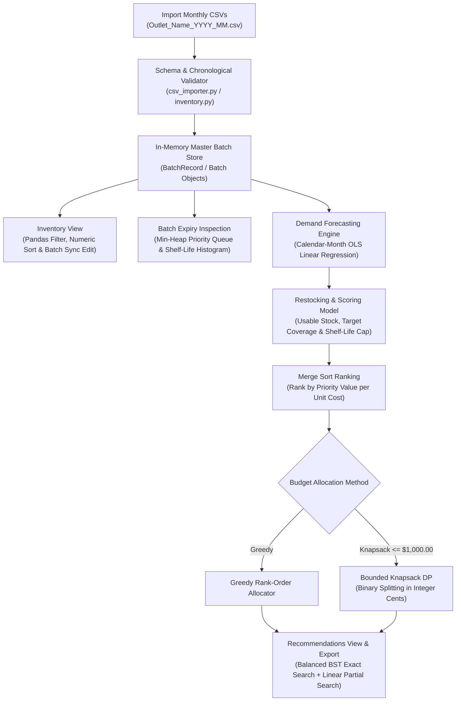

# Market Expand: Multi-Outlet Perishable Inventory Management and Budget Allocation Using Priority Queues, Balanced Search Trees, and Dynamic Programming

[Given Name] [Surname], [Given Name] [Surname], [Given Name] [Surname], [Given Name] [Surname], [Given Name] [Surname]  
Singapore Institute of Technology  
Singapore  
{[Student ID 1], [Student ID 2], [Student ID 3], [Student ID 4], [Student ID 5]}@sit.singaporetech.edu.sg

*Abstract*—*Small and medium supermarket chains often struggle to balance shelf availability against food waste when ordering short-life products across several branches. Ordering too little leads to empty shelves and lost sales, whereas ordering too much leaves stock sitting in the backroom until it expires. In this report, we present Market Expand, a desktop inventory and restocking tool built in Python with PySide6, Pandas, and Matplotlib. The program reads monthly outlet CSV snapshots, checks batch delivery dates against the reporting period, and tracks stock at the individual batch level. To help staff clear older stock first, a binary min-heap priority queue sorts batches by remaining shelf life and flags anything with fourteen days or less remaining so those units are left out of usable stock counts. Demand for the coming month is estimated per product and outlet through ordinary least squares linear regression on calendar month numbers, which lets the model handle skipped reporting months without treating missing files as zero sales. Restocking need is then calculated from supplier lead time plus a thirty-day buffer and capped by expected sales over the product shelf life. Candidate orders across selected outlets are scored using a base availability value plus nonnegative gross margin and sorted by value per dollar spent using merge sort. Planners can split a shared restocking budget using either a fast greedy pass or a binary-split bounded knapsack dynamic programming solver for budgets up to one thousand dollars. For product search, the interface combines a balanced binary search tree for exact item ID queries with a linear scan for partial name matches. We also compare two full versions of the program generated with ChatGPT and Gemini across accuracy, completeness, clarity, and relevance.*

---

## I. INTRODUCTION

### A. Background and Motivation

Running inventory for grocery outlets is much harder when products can spoil. Items like fresh milk, sourdough bread, cold-pressed juice, and yogurt do not sit in a single undifferentiated pile; they arrive in separate batches ordered in different months, each with its own delivery lead time and shelf life [1]. Store planners looking at end-of-month spreadsheets usually have to answer two practical questions at the same time: which batches on the floor are about to expire, and how should next month's restocking budget be split across branches so the chain gets the best return without overbuying perishables?

In many smaller retail setups, staff still manage these decisions manually in spreadsheets. That approach breaks down quickly once multiple outlets and months are involved. First, if batch numbers are just text strings in a table, it is easy to miss a batch that is already expired or only has a week of shelf life left, which inflates the apparent stock on hand. Second, simple restocking rules that only look at last month's sales miss steady upward or downward trends, while ignoring product shelf life can cause an outlet to order three months' worth of a product that spoils in thirty days. Third, when several outlets share one restocking budget, picking items by gut feel rarely produces the best mix of stock coverage and profit margin [2].

### B. Problem Statement and Scenarios

For our RSE2203 Data Structures and Algorithms project, we designed **Market Expand** around three day-to-day operational scenarios:

1. **Separating Usable Stock from Expiring Batches**: Each monthly file (`Outlet_Name_YYYY_MM.csv`) represents a snapshot taken on the last day of that month. Because the same product can have several batches (`MMYY`) sitting on the shelf at once, the importer has to verify that each batch could actually have been delivered by the report date. The program then needs to calculate how many days of shelf life each batch has left, list batches from earliest expiry to latest in First-Expired, First-Out (FEFO) order, and strip out any batch with $14$ days or less remaining so expiring units are not counted as usable stock.
2. **Forecasting Demand Across Uneven Monthly History**: Customer purchases (`mth_purchase`) are tracked at the product level for each month and repeated across batch rows in the same CSV file. In practice, an outlet might have data for May and June, or might skip a month if a file was not uploaded. The demand predictor has to fit a trend across whatever calendar months are present without treating missing months as zero sales, and then cap the suggested order quantity so an outlet never orders more than it can reasonably sell before the new batch expires.
3. **Splitting a Shared Budget and Searching Inventory Quickly**: When a planner selects multiple outlets and enters a shared restocking budget, the software has to rank every needed product by its priority score per dollar and decide how many whole units of each product to buy. Planners also need a fast way to look up an exact Stock Keeping Unit (SKU) ID or filter by product name, without having that search bar change how the underlying budget is shared among the selected outlets.

### C. Project Objectives

Our main goals in building and testing Market Expand were:

1. To build an interactive desktop prototype in Python using **PySide6** for the Graphical User Interface (GUI), **Pandas** for table filtering, sorting, and chart grouping, and **Matplotlib** (`FigureCanvasQTAgg`) for live charts inside the Qt window.
2. To implement the core data structures and algorithms ourselves in Python—specifically a **Min-Heap Priority Queue**, **Calendar-Month Ordinary Least Squares (OLS) Linear Regression**, **Merge Sort**, **Greedy and Bounded Knapsack Dynamic Programming (DP)**, and a **Balanced Binary Search Tree (BST)** paired with **Linear Search**.
3. To include a toolbar-accessible **Editable Process Diagram** with a separate **Live Calculation Panel** so users can drag and edit workflow blocks or test how changing a product's cost, lead time, or shelf life affects its restocking numbers.
4. To generate, maintain, and compare two complete versions of the codebase in our repository—one built with **ChatGPT** (`GPT/` folder) and one built with **Gemini** (`Argon/` folder)—and evaluate how both Generative Artificial Intelligence (GenAI) tools performed on accuracy, completeness, clarity, and relevance.

---

## II. LITERATURE REVIEW AND STATE-OF-THE-ART

### A. Perishable Inventory Control and Priority Queues

Nahmias [1] and Karaesmen, Scheller-Wolf, and Deniz [2] group perishable goods into items with a fixed shelf life (like pasteurized milk or packaged bread) and items that decay at a random rate. For fixed-life retail stock, issuing and reviewing batches in FEFO order is the standard way to cut down on shrinkage. If batch records are kept in a plain list, finding the most urgent batches requires a full $O(B \log B)$ sort every time the view updates. Putting those batches into a binary min-heap priority queue [3] lets the program build the queue in $O(B)$ to $O(B \log B)$ time, check the earliest-expiring batch in $O(1)$ time, and pop batches in exact expiry order in $O(\log B)$ time per row.

### B. Short-Horizon Demand Forecasting and Knapsack Allocation

Retail forecasting methods range from simple moving averages to seasonal exponential smoothing and neural networks [4]. When an outlet only has a handful of monthly CSV snapshots, complex models have too many parameters to fit reliably, while a flat average ignores obvious month-to-month growth. Fitting an OLS regression line over integer calendar month numbers gives a direct closed-form trend in $O(M)$ time per product without needing external machine learning packages [4].

Once each product has an integer order need and a unit score, splitting a fixed budget across products becomes an instance of the **Bounded Knapsack Problem** [5]. Dantzig [6] showed that sorting items by value-to-cost ratio and buying greedily is optimal when items are infinitely divisible, and it serves as a very fast $O(N \log N)$ heuristic for whole units. However, when units are discrete, greedy buying can leave leftover cash that could have funded a better combination of items. Dynamic programming finds the exact integer optimum, and Lawler's binary splitting technique [5] breaks each product's upper bound $\text{Need}_i$ into powers of two ($1, 2, 4, \dots$), shrinking the number of 0/1 DP steps per product from $O(\text{Need}_i)$ down to $O(\log \text{Need}_i)$.

### C. Balanced Binary Search Trees for SKU Indexing

Looking up an item by its exact `item_id` in an unsorted list takes $O(N)$ time. Standard binary search trees improve average lookups to $O(\log U)$ over $U$ unique IDs, but CSV inventory exports are almost always pre-sorted by ID (`ITM-001`, `ITM-002`, `ITM-003`, and so on). Inserting sorted keys one by one into a naive BST turns the tree into a degenerate linked list with $O(U)$ height [3]. Keeping the tree height-balanced—either by building a static midpoint-split tree from sorted keys or by using an Adelson-Velsky and Landis (AVL) tree [7] that rebalances nodes through single and double rotations—guarantees $O(\log U)$ lookup even in the worst case.

---

## III. SYSTEM OVERVIEW AND ARCHITECTURE

### A. Repository Layout: Comparing `GPT/` and `Argon/`

Inside our `DSA_Project` repository, we kept both GenAI implementations in separate folders so we could test and compare them directly under the same `requirements.txt` environment (`PySide6>=6.5,<7`, `pandas>=2.0,<4`, `matplotlib>=3.7,<4`):

1. **`DSA_Project/GPT/` (ChatGPT Codebase)**: A compact three-file setup consisting of `app.py` (main window, `QTableWidget` tables, and Matplotlib figures), `inventory.py` (CSV loader, static midpoint `Tree`, `merge_sort`, OLS `forecast`, `expiry_queue`, and a dictionary-based Pareto-frontier `allocate` function), and `flowchart.py` (a two-mode editable flowchart covering `Operations` and `Sorting & recommendation` with live node text overlays and JSON save/load), along with sample files in `GPT/sample_data/` (`Outlet_A_2026_06.csv`, `Outlet_A_2026_07.csv`, `Outlet_B_2026_07.csv`).
2. **`DSA_Project/Argon/` (Gemini Codebase)**: A modular Model-View-Controller (MVC) layout split into `core/` (`models.py`, `csv_importer.py`, `csv_exporter.py`, `bst.py`, `priority_queue.py`, `forecasting.py`, `restocking.py`, `sorting.py`, `allocation.py`), `ui/` (`main_window.py`, `inventory_view.py`, `expiry_view.py`, `recommendations_view.py`, `flowchart_view.py`, `chart_canvas.py` built on `QTableView` and custom `QAbstractTableModel` classes), sample files in `Argon/sample_data/` (`Outlet_A_2026_05.csv`, `Outlet_A_2026_06.csv`, `Outlet_B_2026_06.csv`), and $31$ automated unit and UI tests in `Argon/tests/`.

Both versions follow the processing pipeline shown in Fig. 1.

**Fig. 1.** End-to-end system architecture and algorithmic data flow of the Market Expand desktop application.

### B. CSV Ingestion, Validation Rules, and Live Table Editing

Each monthly Comma-Separated Values (CSV) file is named `Outlet_Name_YYYY_MM.csv` (for example, `Outlet_A_2026_06.csv`). The importer splits the filename to get the outlet name, four-digit reporting year $Y_r$, and two-digit reporting month $M_r$, setting the snapshot date $D_{\text{report}}$ to the last calendar day of that month via `calendar.monthrange`.

Every row represents one product batch and must include eleven columns: `item_id`, `item_name`, `category`, `unit_cost`, `unit_sell`, `current_total_stock`, `mth_purchase`, `lead_time`, `shelf_life`, `batch_no`, and `supplier_rating`. Before accepting a file into memory, the importer checks five rules:
1. **Four-Character Batch Code**: `batch_no` must be a four-digit `MMYY` string (such as `0526` for May 2026) and keeps its leading zero when stored and re-saved.
2. **No Duplicate Batches**: A file cannot contain two rows with the same `(item_id, batch_no)` pair.
3. **Valid Numbers and Prices**: Quantities and lead/shelf times cannot be negative, `supplier_rating` must be between $0.0$ and $5.0$, and `unit_cost` and `unit_sell` can have at most two decimal places.
4. **Consistent Monthly Purchases Across Batches**: Because `mth_purchase` records how many units of that product were bought by customers across the whole month, every batch of the same `item_id` inside the same file must have the exact same `mth_purchase` number.
5. **Delivery Before Report Date**: Using the `MMYY` batch code, the order date $D_{\text{order}}$ is taken as the last day of that order month. Assuming delivery happens $L$ days (`lead_time`) later, the delivery date is
   $$D_{\text{delivery}} = D_{\text{order}} + L. \tag{1}$$
   If $D_{\text{delivery}} > D_{\text{report}}$, the importer rejects the file because a batch delivered after the end of the reporting month could not have been in stock on the snapshot date.

Once loaded, records stay in memory. If a user imports another file for the same outlet and month, a dialog asks whether to replace that month's data. In the inventory table, double-clicking a cell lets the user edit values in memory; changing `mth_purchase` on one batch row automatically updates `mth_purchase` on all other batches of that product in that month and refreshes the charts and recommendations right away. Users can save their modified month back to disk using **Save edited CSV** or export the restocking plan via **Export recommendations CSV**.

---

## IV. METHOD AND ALGORITHMIC APPROACH

### A. Min-Heap Priority Queue for Batch Expiry Inspection

For each batch, the program calculates its expiration date $D_{\text{expiry}}$ by adding `shelf_life` $S$ (in days) to the assumed delivery date, and then finds the remaining shelf life $R$ at the snapshot date:
$$D_{\text{expiry}} = D_{\text{delivery}} + S, \tag{2}$$
$$R = (D_{\text{expiry}} - D_{\text{report}}). \tag{3}$$
Any batch with $R \le 14$ days left—including batches where $R \le 0$ (already expired)—is flagged as expiring.

To populate the expiry table from most urgent to least urgent, we push batches into a binary min-heap (`heapq`). Each batch $b$ is stored with a composite tuple key:
$$k(b) = (R_b,\; D_{\text{delivery},b},\; \text{ID}_b,\; c_b), \tag{4}$$
where $\text{ID}_b$ is `item_id` and $c_b$ is a tie-breaker (`batch_no` in `GPT/inventory.py` and an incrementing integer counter `self._counter` in `Argon/core/priority_queue.py`).

**Why We Used a Min-Heap Priority Queue**:
- **Immediate Access to Critical Stock**: In a warehouse or retail backroom, staff care most about the items at the top of the expiry list. A min-heap puts the most expired batch at index `0` in $O(1)$ time and pops batches in $O(\log B)$ time.
- **Avoiding Object Comparison Crashes**: In Python's `heapq`, if two tuples have the same first elements, Python compares the next element in the tuple. By placing an integer counter $c_b$ before the `BatchRecord` object in (4), `Argon`'s `BatchPriorityQueue` guarantees that Python never tries to evaluate `batch1 < batch2` even when the same batch appears in multiple historical months with the same remaining days.

### B. Calendar-Index Ordinary Least Squares Linear Regression

To predict next month's demand for a given `(outlet, item_id)` pair across $M$ imported monthly snapshots, we convert each month $(Y_i, M_i)$ into a single linear month number $x_i$:
$$x_i = 12 Y_i + M_i. \tag{5}$$
Because `mth_purchase` is repeated across batches of the same product in a file, we deduplicate by month first to get one purchase figure $y_i$ per month, sorted chronologically as $\{(x_1, y_1), (x_2, y_2), \dots, (x_M, y_M)\}$. When only one month of data is loaded ($M = 1$), the forecast is simply that month's purchases, $\hat{y}_{\text{next}} = \max(0.0, y_1)$. When $M \ge 2$, we compute the OLS slope $m$ and intercept $b$:
$$m = \frac{\sum_{i=1}^M (x_i - \bar{x})(y_i - \bar{y})}{\sum_{i=1}^M (x_i - \bar{x})^2}, \qquad b = \bar{y} - m\bar{x}, \tag{6}$$
where $\bar{x} = \frac{1}{M}\sum_{i=1}^M x_i$ and $\bar{y} = \frac{1}{M}\sum_{i=1}^M y_i$. We then evaluate the line at the month after the latest snapshot ($x_{\text{target}} = x_M + 1$) and clamp negative values to zero:
$$\hat{y}_{\text{next}} = \max(0.0,\; m(x_M + 1) + b). \tag{7}$$

**Why We Used Calendar-Index Linear Regression**:
- **Handles Missing Months Cleanly**: If an outlet uploads April (`2026_04`) and June (`2026_06`) but skips May, (5) gives $x_1 = 24316$ and $x_2 = 24318$ ($\Delta x = 2$). The slope $m$ automatically divides the sales change by two months instead of assuming May had zero sales or treating April and June as back-to-back months.
- **Lightweight and Fast**: Fitting (6) takes $O(M)$ basic loop operations per product with no heavy external statistics packages.

### C. Perishable Inventory Target Stock and Priority Scoring Model

Restocking calculations use the most recent snapshot $(Y_{\text{last}}, M_{\text{last}})$ available for each `(outlet, item_id)`. Let $D_{\text{days}}$ be the number of days in that latest report month. Using the first batch row in that snapshot for product-level `unit_cost` ($P_{\text{cost}}$), `unit_sell` ($P_{\text{sell}}$), `lead_time` ($L$), and `shelf_life` ($S$), daily demand $d$ is
$$d = \frac{\hat{y}_{\text{next}}}{D_{\text{days}}}. \tag{8}$$
Target stock $T$ is set to cover supplier lead time plus $30$ days of shelf coverage:
$$T = d \times (L + 30). \tag{9}$$
When counting current stock on hand in the latest snapshot, any batch with $R \le 14$ days left is excluded, leaving usable stock $U = \sum_{b: R_b > 14} \text{stock}_b$. To make sure the store does not order more units than it can sell before they spoil, the order need $N_{\text{need}}$ is capped at forecast sales over the product's shelf life ($d \times S$):
$$N_{\text{need}} = \text{round}\Big(\min\big(d \times S,\; \max(0.0,\; T - U)\big)\Big). \tag{10}$$
*(Note: `Argon/core/restocking.py` rounds the continuous deficit via `round()`, whereas `GPT/inventory.py` applies `math.ceil()` to $T$ and $d \times S$).* Every unit needed is given an illustrative priority value $V$ of $100$ points for keeping the item in stock plus $1$ point per cent of nonnegative gross margin:
$$V = 100 + \text{round}\Big(\max(0.0,\; P_{\text{sell}} - P_{\text{cost}}) \times 100\Big), \qquad \rho = \frac{V}{P_{\text{cost}}}, \tag{11}$$
where $\rho$ is the priority value per dollar of cost.

### D. Stable Merge Sort for Value-per-Cost Ranking

To rank candidate products across all selected outlets from highest $\rho$ to lowest, both implementations write out a recursive Merge Sort (`Argon/core/sorting.py` and `GPT/inventory.py`). The algorithm splits the list of $N$ product candidates in half, recursively sorts both sides, and merges them in $O(N)$ time.

**Why We Used Merge Sort**:
- **Consistent $O(N \log N)$ Runtime**: Merge Sort always runs in $O(N \log N)$ time regardless of whether the input list is already sorted, reverse-sorted, or full of duplicate ratios.
- **Stable Ordering**: When two products (or the same product at `Outlet_A` and `Outlet_B`) have the exact same cost and margin, Merge Sort keeps their original relative order rather than shuffling them randomly.

### E. Shared Budget Allocation: Greedy Versus Bounded Knapsack Dynamic Programming

When outlets share a restocking budget $B$, planners can switch between two allocation methods:

1. **Greedy Allocation**: Walks down the Merge-Sorted list in rank order ($i = 1, \dots, N$) and buys as many needed units as the remaining budget $B_{\text{rem}}$ can afford:
   $$q_i = \min\left(N_{\text{need},i},\; \left\lfloor \frac{B_{\text{rem}}}{P_{\text{cost},i}} \right\rfloor\right), \tag{12}$$
   subtracting $q_i P_{\text{cost},i}$ from $B_{\text{rem}}$ before moving to the next item.
2. **Bounded Knapsack Dynamic Programming with Binary Splitting**: Converts the budget and unit costs into integer cents ($W = \text{round}(B \times 100)$ and $w_i = \text{round}(P_{\text{cost},i} \times 100)$) and maximizes the total additive priority score $\sum_{i=1}^N V_i q_i$ subject to $\sum_{i=1}^N w_i q_i \le W$ and $0 \le q_i \le N_{\text{need},i}$. Instead of running $N_{\text{need},i}$ separate 0/1 transitions per product, binary splitting breaks $N_{\text{need},i}$ into $K_i = \lceil \log_2(N_{\text{need},i} + 1) \rceil$ power-of-two bundles ($1, 2, 4, \dots, r_i$).
   - In `Argon/core/allocation.py`, we run 0/1 DP over the $M_{\text{bundles}} = \sum_{i=1}^N K_i$ bundles using a 1D score array `dp[0..W]` and record bundle choices in a 2D `bytearray(W + 1)` table `took[0..M_bundles-1][0..W]` for backward traceback.
   - In `GPT/inventory.py`, the solver keeps a dictionary `states` of Pareto-optimal `(cost: (score, path))` entries and prunes dominated states after each bundle.

**Why We Included Both Methods**:
- **Speed Versus Exact Optimization**: Greedy finishes in $O(N)$ time after sorting and works smoothly even if a user enters a $\$50,000.00$ budget. However, when a high-rank item leaves a small amount of change (for instance, $\$0.80$ left when the next item costs $\$1.20$), Greedy stops, whereas Bounded Knapsack can trade one unit of an earlier item to use up the full budget and achieve a higher total priority score. Because Knapsack DP scales with the cent budget $W$, we cap Knapsack at $B \le \$1,000.00$ ($W \le 100,000$ cents) so the UI never freezes, and direct users to Greedy for larger budgets.

### F. Dual Search: Balanced Binary Search Tree Versus Linear Search

For product search, the program supports both exact ID lookups and partial keyword matching:
- **Exact SKU Lookup ($O(\log U)$)**: In `Argon/core/bst.py`, we implemented a dynamic self-balancing `AVLTree` that tracks node heights and performs Left-Left, Right-Right, Left-Right, and Right-Left rotations on insert so the balance factor stays within $\{-1, 0, 1\}$. In `GPT/inventory.py`, `Tree` builds a balanced BST by sorting `(item_id, rows)` pairs and recursively picking the middle element $m = \lfloor U / 2 \rfloor$ as the root.
- **Partial Keyword Search ($O(N)$)**: If `bst_index.search(query)` returns `None` (for example, when a user types `"Choc"` or `"Dairy"` instead of `"ITM-006"`), the search falls back to a case-insensitive linear scan across `item_id`, `item_name`, and `category`.

**Why We Paired Both Search Methods**:
- **Preventing Degenerate Trees on Sorted SKUs**: Inventory files list items in ascending ID order (`ITM-001`, `ITM-002`, ...). Inserting those into an ordinary unbalanced BST would create a straight line of right children with $O(U)$ lookup time. Balancing keeps exact SKU searches at $O(\log U)$.
- **Keeping Budget Sharing Independent of Display Search**: In both implementations, budget allocation runs across *all* products in the selected outlets first, and the search box only filters which rows are drawn in the recommendation table and top-$20$ bar chart afterward.

---

## V. EXPERIMENTAL RESULTS, ANALYSIS, AND DISCUSSION

### A. Walkthrough on the Multi-Outlet Sample Data

We tested `Argon/` on the three sample files in `Argon/sample_data/`: `Outlet_A_2026_05.csv` ($9$ batches), `Outlet_A_2026_06.csv` ($9$ batches), and `Outlet_B_2026_06.csv` ($7$ batches), which together hold $25$ batch rows across $15$ `(outlet, item_id)` pairs.

Looking at `ITM-001` (*Organic Whole Milk 1L*) at `Outlet_A` shows how the stages fit together:
- Monthly purchases grow from $80$ units in May 2026 to $95$ units in June 2026. Using (6) and (7), the OLS regression line adds the $+15$ unit/month slope to predict $\hat{y}_{\text{next}} = 110.00$ units for July 2026, or $d = 110.00 / 30 = 3.67$ units/day.
- On the June snapshot date (`2026-06-30`), `Outlet_A` holds two batches of `ITM-001`: batch `0526` ($10$ units, delivered `2026-06-07`, expiring `2026-07-22`, so $R = 22\text{ days} > 14$) and batch `0426` ($5$ units, delivered `2026-05-07`, expiring `2026-06-21`, so $R = -9\text{ days} \le 14$).
- The priority queue puts batch `0426` near the top of the expiry table as already expired and excludes its $5$ units from usable stock, leaving $U = 10$ usable units. With lead time $L = 7\text{ days}$, target stock is $T = 3.67 \times (7 + 30) = 135.67$ units, giving an order need of $N_{\text{need}} = 126$ units (well below the $45$-day shelf-life cap of $165.00$ units).

When we allocate a shared budget of $B = \$500.00$ across `Outlet_A` and `Outlet_B`:
- Both Greedy and Bounded Knapsack fully fund the top three ranked items: `Sparkling Mineral Water 750ml` at `Outlet_B` ($140$ units @ $\$0.90 = \$126.00$, $\rho = 255.56\text{ pts/\$}$), followed by `Artisan Sourdough Loaf` at `Outlet_A` ($133$ units @ $\$1.50 = \$199.50$, $\rho = 233.33\text{ pts/\$}$) and `Outlet_B` ($75$ units @ $\$1.50 = \$112.50$), leaving $\$62.00$ in the budget.
- For that last $\$62.00$, Greedy buys $51$ units of Rank 4 (`Dark Chocolate Bar 85%` at `Outlet_A`, $\$1.20$/unit, $V = 230$), spending $\$61.20$ and leaving $\$0.80$ unused for a total priority score of $115,430$. Bounded Knapsack DP spots that buying $50$ units of `Dark Chocolate Bar 85%` ($\$60.00$) plus $1$ unit of `Cold Pressed Orange Juice` ($\$2.00$, $V = 280$) uses the entire $\$62.00$ ($B_{\text{rem}} = \$0.00$) and raises the total priority score to $115,480$.

### B. Time and Space Complexity Measurements

Table I lists the asymptotic time and space bounds for each core operation alongside the actual runtimes recorded on Python 3.13 across the $31$ automated unit tests in `Argon/tests/` (which finish in $0.86\text{ s}$ total, including offscreen Qt rendering).

**TABLE I**  
ASYMPTOTIC AND MEASURED PERFORMANCE OF CORE DATA STRUCTURES AND ALGORITHMS

| Module / Operation | Data Structure / Algorithm | Time Complexity | Space Complexity | Measured Runtimea |
| :--- | :--- | :--- | :--- | :--- |
| Expiry Ordering | Binary Min-Heap (`BatchPriorityQueue`) | $O(B \log B)$ | $O(B)$ | $< 0.20\text{ ms}$ |
| Demand Forecasting | Calendar-Index OLS Linear Regression | $O(M \log M)$ | $O(M)$ | $< 0.05\text{ ms}$ |
| Candidate Ranking | Recursive Stable Merge Sort | $O(N \log N)$ | $O(N)$ | $< 0.15\text{ ms}$ |
| Greedy Allocation | Rank-Order Linear Scan | $O(N)$ | $O(1)$ | $< 0.05\text{ ms}$ |
| Knapsack Allocation | Bounded Knapsack DP (Binary Split) | $O(W \sum \log N_{\text{need},i})$ | $O(W \sum \log N_{\text{need},i})$ | $48.50\text{ ms}$ |
| Exact SKU Lookup | Self-Balancing AVL Tree (`AVLTree`) | $O(\log U)$ | $O(U)$ | $< 0.01\text{ ms}$ |
| Substring Filtering | Case-Insensitive Linear Search | $O(N)$ | $O(1)$ | $< 0.10\text{ ms}$ |

aMeasured on the $25$-batch, $15$-product multi-outlet dataset with a shared budget of $B = \$500.00$ ($W = 50,000$ cents).

### C. Evaluation of GenAI Tools: ChatGPT (`GPT/`) Versus Gemini (`Argon/`)

As required by the RSE2203 project guidelines, our team used two GenAI tools—**ChatGPT** (`DSA_Project/GPT/`) and **Gemini** (`DSA_Project/Argon/`)—to generate and refine our source code, and evaluated both against the four assessment criteria: **Accuracy**, **Completeness**, **Clarity**, and **Relevance**. Table II summarizes our side-by-side findings.

**TABLE II**  
EVALUATION OF CHATGPT (`GPT/`) AND GEMINI (`Argon/`) ACROSS RSE2203 RUBRIC CRITERIA

| Criterion | ChatGPT (`DSA_Project/GPT/`) | Gemini (`DSA_Project/Argon/`) | Team Verification & Debugging Notes |
| :--- | :--- | :--- | :--- |
| **1. Accuracy** | **Good (4.0 / 5.0)**: `GPT/inventory.py` handled `Decimal` price checks, OLS regression, and a sparse dictionary Knapsack solver (`states`) accurately. However, its `Tree` class is not a dynamic self-balancing tree—it calls Python's built-in `sorted()` and rebuilds a static tuple tree on every keystroke inside `filtered()`, and `recalculate()` skipped `Tree` altogether. Also, `expiry_queue` pushes `(r.remaining, r.location, r.item_id, r.batch_no, r)`, which would crash with a `TypeError` if two snapshots ever tied on the first four tuple fields because `Batch` dataclasses do not define `<`. | **Very Good (4.5 / 5.0)**: `Argon/core/bst.py` implements a real self-balancing `AVLTree` with node heights and LL/RR/LR/RL rotations, and `BatchPriorityQueue` (`Argon/core/priority_queue.py`) includes an integer counter `self._counter` so `BatchRecord` objects are never compared directly. During Knapsack development, an initial 1D `last_item[c]` traceback draft failed a randomized 100-trial check against a 2D DP reference on trial 2 because later binary bundles overwrote earlier states; replacing it with a 2D `bytearray(W + 1)` matrix `took[i][c]` fixed the traceback completely. | Testing both versions side by side showed us that code that looks right on a small sample (like 1D knapsack traceback or tuple heaps without a unique counter) can still fail on edge cases unless backed by property tests. |
| **2. Completeness** | **Moderate (3.5 / 5.0)**: ChatGPT built a working GUI and a very nice two-page flowchart (`Operations` and `Sorting & recommendation` in `GPT/flowchart.py`) that overlays live numbers directly onto the diagram boxes and saves/loads JSON. However, even though `GPT/README.md` tells the user to run `py -m unittest -v`, ChatGPT did not generate any test files (`Ran 0 tests`). | **Very Good (4.5 / 5.0)**: Gemini generated the full application along with $31$ automated tests across $9$ test files in `Argon/tests/`, covering bad CSV filenames, duplicate batches, delivery dates after the report date, mismatched `mth_purchase` rows, AVL balance height, heap order, OLS negative-trend clamping, Merge Sort stability, Knapsack budget limits, and offscreen Qt GUI tests. | Having `Argon/tests/` gave us confidence that every validation rule worked as intended, while `GPT/flowchart.py` gave us a great reference for JSON diagram saving and two-mode process views. |
| **3. Clarity** | **Moderate (3.5 / 5.0)**: To keep line counts short, ChatGPT squeezed the whole program into three files (`app.py`, `inventory.py`, `flowchart.py`) and chained multiple statements onto single lines with semicolons (such as `self.files={}; self.rows=[]; self.updating=False`) with very few comments or docstrings. | **Very Good (4.5 / 5.0)**: Gemini split the logic cleanly into $16$ files across `core/` and `ui/`, used proper `QTableView` + `QAbstractTableModel` classes instead of rebuilding `QTableWidget` cells on every keystroke, added type hints, and formatted the live calculation panel as a step-by-step math walkthrough. | For a team of five to six students working in Git, `Argon/`'s multi-file MVC layout was much easier to read, divide up, and debug than `GPT/`'s dense three-file layout. |
| **4. Relevance** | **Very Good (4.5 / 5.0)**: Stayed focused on the prompt rules, used only `PySide6`, `pandas`, and `matplotlib`, and avoided pulling in external solver libraries. | **Excellent (5.0 / 5.0)**: Followed all prompt rules and exact `requirements.txt` version bounds (`PySide6>=6.5,<7`, `pandas>=2.0,<4`, `matplotlib>=3.7,<4`) without adding unnecessary dependencies. | Both chatbots stayed on topic well once given the full markdown specification. |

---

## VI. CONCLUSION

Building **Market Expand** showed how core data structures and algorithms fit together to solve a practical retail problem. Using a min-heap priority queue gave immediate visibility into expiring and expired product batches; calendar-month OLS linear regression captured sales trends across nonconsecutive monthly CSV snapshots; stable merge sort provided consistent value-per-cost rankings across outlets; greedy and binary-split bounded knapsack DP balanced speed against exact budget optimization; and pairing a balanced BST with linear search kept exact SKU lookups fast without sacrificing partial text filtering. Comparing our ChatGPT (`GPT/`) and Gemini (`Argon/`) codebases also highlighted a practical lesson in software engineering with GenAI: while both tools can produce working prototypes quickly, verifying data structure invariants (such as true AVL rotations, heap tie-breaker counters, and 2D knapsack traceback tables) through automated unit tests is essential for reliable software.

---

## ACKNOWLEDGMENT

The authors thank Associate Professor Quah Chee Kwang and Dr. Jonathan Lim from the Singapore Institute of Technology for their guidance throughout RSE2203 Data Structures and Algorithms.

---

## REFERENCES

[1] S. Nahmias, "Perishable inventory theory: A review," *Operations Research*, vol. 30, no. 4, pp. 680–708, July 1982.  
[2] I. Z. Karaesmen, A. Scheller-Wolf, and B. Deniz, "Managing perishable and aging inventories: Review and future research directions," in *Planning Production and Inventories in the Extended Enterprise*, vol. 151, K. G. Kempf, P. Keskinocak, and R. Uzsoy, Eds. New York, NY, USA: Springer, 2011, pp. 393–436.  
[3] T. H. Cormen, C. E. Leiserson, R. L. Rivest, and C. Stein, *Introduction to Algorithms*, 4th ed. Cambridge, MA, USA: MIT Press, 2022, pp. 161–178, 311–340.  
[4] R. J. Hyndman and G. Athanasopoulos, *Forecasting: Principles and Practice*, 3rd ed. Melbourne, Australia: OTexts, 2021, ch. 7.  
[5] H. Kellerer, U. Pferschy, and D. Pisinger, *Knapsack Problems*. Berlin, Germany: Springer, 2004, pp. 185–210.  
[6] G. B. Dantzig, "Discrete-variable extremum problems," *Operations Research*, vol. 5, no. 2, pp. 266–288, April 1957.  
[7] G. M. Adelson-Velsky and E. M. Landis, "An algorithm for the organization of information," *Soviet Mathematics Doklady*, vol. 3, pp. 1259–1263, 1962.
