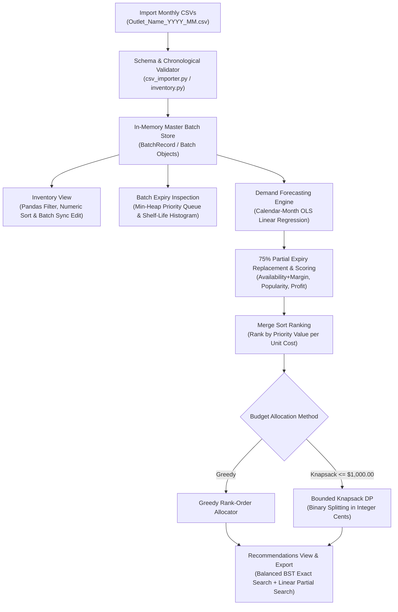

# Market Expand: Multi-Outlet Perishable Inventory Management and Budget Allocation Using Priority Queues, Balanced Search Trees, and Dynamic Programming

[Given Name] [Surname], [Given Name] [Surname], [Given Name] [Surname], [Given Name] [Surname], [Given Name] [Surname]  
Singapore Institute of Technology  
Singapore  
{[Student ID 1], [Student ID 2], [Student ID 3], [Student ID 4], [Student ID 5]}@sit.singaporetech.edu.sg

*Abstract*—*Small and medium supermarket chains often struggle to balance shelf availability against food waste when ordering short-life products across several branches. Ordering too little leads to empty shelves and lost sales, whereas ordering too much leaves stock sitting in the backroom until it expires. In this report, we present Market Expand, a desktop inventory and restocking tool built in Python with PySide6, Pandas, and Matplotlib. The program reads monthly outlet CSV snapshots, checks batch delivery dates against the reporting period, and tracks stock at the individual batch level. To help staff clear older stock first, a binary min-heap priority queue sorts batches by remaining shelf life and flags near-expiry and expired batches. Demand for the coming month is estimated per product and outlet through ordinary least squares linear regression on calendar month numbers, which lets the model handle skipped reporting months without treating missing files as zero sales. To gradually reduce overstock on slow-moving perishables without abruptly halting replenishment, restocking need is calculated using a partial expiry replacement rule that replaces all units sold in the reporting month plus seventy-five percent of units that expired that month, rounded down. Candidate orders across selected outlets are scored under three selectable objectives—Availability plus margin, Popularity from forecast monthly sales, or Profit from nonnegative gross margin in cents—and ranked by score per dollar spent using merge sort. Planners can split a shared restocking budget using either a fast greedy pass or a binary-split bounded knapsack dynamic programming solver for budgets up to one thousand dollars. For product search, the interface combines a balanced binary search tree for exact item ID queries with a linear scan for partial name matches. Finally, we compare our two complete implementations generated with ChatGPT and Gemini across accuracy, completeness, clarity, and relevance.*

---

## I. INTRODUCTION

### A. Background and Motivation

Running inventory for grocery outlets is much harder when products can spoil. Items like fresh milk, sourdough bread, cold-pressed juice, and yogurt do not sit in a single undifferentiated pile; they arrive in separate batches ordered in different months, each with its own delivery lead time and shelf life [1]. Store planners looking at end-of-month spreadsheets usually have to answer two practical questions at the same time: which batches on the floor are about to expire, and how should next month's restocking budget be split across branches so the chain gets the best return without overbuying perishables?

In many smaller retail setups, staff still manage these decisions manually in spreadsheets. That approach breaks down quickly once multiple outlets and months are involved. First, if batch numbers are just text strings in a table, it is easy to miss a batch that is already expired or only has a week of shelf life left, which inflates the apparent stock on hand. Second, if a store replaces $100\%$ of expired stock every month, slow-selling products keep expiring at the same rate; conversely, cutting orders to zero causes sudden stockouts. Third, different retail strategies call for different buying priorities: a store might want to balance baseline availability with margin (**Availability + margin**), prioritize fast-moving everyday items (**Popularity**), or maximize gross margin dollars (**Profit**) across branches sharing one procurement budget [2].

### B. Problem Statement and Scenarios

For our RSE2203 Data Structures and Algorithms project, we designed **Market Expand** around three day-to-day operational scenarios:

1. **Batch-Level Expiry Ordering and Monthly Loss Tracking**: Each monthly file (`Outlet_Name_YYYY_MM.csv`) represents a snapshot taken on the last day of that month. Because the same product can have several batches (`MMYY`) sitting on the shelf at once, the importer has to verify that each batch could actually have been delivered by the report date. The program then needs to calculate how many days of shelf life each batch has left, list batches from earliest expiry to latest in First-Expired, First-Out (FEFO) order, exclude already-expired units ($R \le 0$) from available stock, flag near-expiry stock ($1 \le R \le 14\text{ days}$) for review, and track how many units expired during the reporting month (either from an explicit `mth_expired` column or estimated from current-month batch expiry dates).
2. **Gradual Stock Reduction via Partial Expiry Replacement and Trend Forecasting**: Customer purchases (`mth_purchase`) and optional monthly expiry losses (`mth_expired`) are tracked at the product level for each month and repeated across batch rows in the same CSV file. To shrink overstocked items smoothly over time, the system replaces $100\%$ of units sold that month plus $\lfloor 75\% \times \text{units expired that month} \rfloor$. Meanwhile, for the **Popularity** objective, the demand predictor fits an ordinary least squares trend across whatever calendar months are present without treating missing months as zero sales.
3. **Multi-Objective Shared Budget Allocation and Fast SKU Lookup**: When a planner selects one or more outlets, chooses a restocking objective (**Availability + margin**, **Popularity**, or **Profit**), optionally selects an **As of** reporting month cutoff, and enters a shared restocking budget, the software ranks every needed product by its priority score per dollar and decides how many whole units of each product to buy while skipping any product with a zero score. Planners also need a fast way to look up an exact Stock Keeping Unit (SKU) ID or filter by product name, without having that search bar change how the underlying budget is shared among the selected outlets.

### C. Project Objectives

Our main goals in building and testing Market Expand were:

1. To build an interactive desktop application in Python using **PySide6** for the Graphical User Interface (GUI), **Pandas** for table filtering, sorting, and chart grouping, and **Matplotlib** (`FigureCanvasQTAgg`) for live charts inside the Qt window.
2. To implement the core data structures and algorithms ourselves in Python—specifically a **Min-Heap Priority Queue**, **Calendar-Month Ordinary Least Squares (OLS) Linear Regression**, **75% Partial Expiry Replacement**, **Merge Sort**, **Greedy and Bounded Knapsack Dynamic Programming (DP)** across three selectable objectives, and a **Balanced Binary Search Tree (BST)** paired with **Linear Search**.
3. To include a toolbar-accessible **Editable Process Diagram** with a **Live Calculation Panel** so users can drag and edit workflow blocks or test how changing a product's sales, monthly expired units, or prices affects its restocking numbers.
4. To maintain and compare two complete versions of the application in our repository—one built with **ChatGPT** (`GPT/` folder) and one built with **Gemini** (`Argon/` folder)—and evaluate both Generative Artificial Intelligence (GenAI) tools on accuracy, completeness, clarity, and relevance.

---

## II. LITERATURE REVIEW AND STATE-OF-THE-ART

### A. Perishable Inventory Control and Priority Queues

Nahmias [1] and Karaesmen, Scheller-Wolf, and Deniz [2] group perishable goods into items with a fixed shelf life (like pasteurized milk or packaged bread) and items that decay at a random rate. For fixed-life retail stock, issuing and reviewing batches in FEFO order is the standard way to cut down on shrinkage. If $n$ batch records are kept in a plain list, finding the most urgent batches requires a full $O(n \log n)$ sort every time the view updates. Putting those batches into a binary min-heap priority queue [3] lets the program build the queue in $O(n)$ to $O(n \log n)$ time, check the earliest-expiring batch in $O(1)$ time, and pop batches in exact expiry order in $O(\log n)$ time per row.

### B. Short-Horizon Demand Forecasting and Knapsack Allocation

Retail forecasting methods range from simple moving averages to seasonal exponential smoothing and neural networks [4]. When an outlet only has a handful of monthly CSV snapshots, complex models have too many parameters to fit reliably, while a flat average ignores obvious month-to-month growth. Fitting an OLS regression line over $n$ integer calendar month numbers gives a direct closed-form trend in $O(n)$ time per product without needing external machine learning packages [4].

Once each product has an integer order need and a unit score under the chosen objective, splitting a fixed budget across $n$ products becomes an instance of the **Bounded Knapsack Problem** [5]. Dantzig [6] showed that sorting items by value-to-cost ratio and buying greedily is optimal when items are infinitely divisible, and it serves as a very fast $O(n \log n)$ heuristic for whole units. However, when units are discrete, greedy buying can leave leftover cash that could have funded a better combination of items. Dynamic programming finds the exact integer optimum, and Lawler's binary splitting technique [5] breaks each product's upper bound $\text{Need}_i$ into powers of two ($1, 2, 4, \dots$), shrinking the number of 0/1 DP steps per product from $O(\text{Need}_i)$ down to $O(\log \text{Need}_i)$.

### C. Balanced Binary Search Trees for SKU Indexing

Looking up an item by its exact `item_id` in an unsorted list of $n$ records takes $O(n)$ time. Standard binary search trees improve average lookups to $O(\log n)$ over $n$ unique IDs, but CSV inventory exports are almost always pre-sorted by ID (`ITM-001`, `ITM-002`, `ITM-003`, or `P001` through `P100`). Inserting sorted keys one by one into a naive BST turns the tree into a degenerate linked list with $O(n)$ height [3]. Keeping the tree height-balanced—either by building a static midpoint-split tree from sorted keys or by using an Adelson-Velsky and Landis (AVL) tree [7] that rebalances nodes through single and double rotations—guarantees $O(\log n)$ lookup even in the worst case.

---

## III. SYSTEM OVERVIEW AND ARCHITECTURE

### A. Dual-Implementation Repository Layout (`GPT/` and `Argon/`)

Inside our `DSA_Project` repository, both GenAI implementations share the same `requirements.txt` specification (`PySide6>=6.5,<7`, `pandas>=2.0,<4`, `matplotlib>=3.7,<4`) and implement the full restocking specification, including the 75% partial expiry replacement policy and the three restocking objectives documented in `RESTOCKING_MODES.md`:

1. **`DSA_Project/GPT/` (ChatGPT Implementation)**: Structured around three core script files:
   - `inventory.py`: Implements CSV loading (`Decimal` price validation requiring `unit_cost > 0` and optional `mth_expired` validation), static midpoint `Tree`, `linear_search`, `merge_sort`, calendar-month OLS `forecast`, `monthly_expired_units()`, `recommendations(records, objective)` using the 75% expiry replacement rule, `expiry_queue`, and `allocate()` using a sparse Pareto-frontier dictionary (`states`) with `AllocationCancelled` checks.
   - `app.py`: Implements the `QMainWindow` GUI using `QTableWidget`, an `As of:` reporting month selector, embedded Matplotlib charts, and a background `QThreadPool` worker (`AllocationTask` with a $250\text{ ms}$ debounce `QTimer` and generation counter `self._generation`) so multi-second dictionary Knapsack runs do not freeze the interface.
   - `flowchart.py`: Implements a two-group editable diagram (`Operations` and `Sorting & recommendation`) that overlays live preview values directly onto the flowchart nodes and supports JSON save/load and edge connection editing.
   - Includes `test_restocking_modes.py` ($9$ unit and offscreen GUI tests) and sample CSV datasets in `GPT/sample_data/` (including `expiry_series/Outlet_ExpirySeries_2026_07..11.csv`, `Outlet_C`, `Outlet_Community`, `Outlet_Youth`, `Outlet_ExpiryDemo`, `Outlet_GradualDemo`, and `Outlet_OverstockDemo`).
2. **`DSA_Project/Argon/` (Gemini Implementation)**: Structured as a decoupled Model-View-Controller (MVC) package:
   - `core/`: Nine pure-Python domain modules (`models.py`, `csv_importer.py`, `csv_exporter.py`, `priority_queue.py`, `forecasting.py`, `restocking.py`, `sorting.py`, `allocation.py`, and `bst.py`) with zero GUI dependencies.
   - `ui/`: Six PySide6 presentation modules (`main_window.py`, `inventory_view.py`, `expiry_view.py`, `recommendations_view.py`, `flowchart_view.py`, and `chart_canvas.py`) built on `QTableView` and custom `QAbstractTableModel` subclasses (`BatchTableModel`, `ExpiryTableModel`, `RecommendationTableModel`).
   - Includes $39$ automated unit and UI tests across $9$ test files in `Argon/tests/` and all sample CSV datasets in `Argon/sample_data/` (including `expiry_series/`).

Both codebases follow the algorithmic pipeline shown in Fig. 1.

**Fig. 1.** End-to-end system architecture and algorithmic data flow of the Market Expand desktop application.

### B. CSV Ingestion, Validation Rules, and Live Table Editing

Each monthly Comma-Separated Values (CSV) file is named `Outlet_Name_YYYY_MM.csv` (for example, `Outlet_C_2026_09.csv`). The importer splits the filename to get the outlet name, four-digit reporting year $Y_r$, and two-digit reporting month $M_r$, setting the snapshot date $D_{\text{report}}$ to the last calendar day of that month via `calendar.monthrange`.

Every row represents one product batch and must include eleven required columns (`item_id`, `item_name`, `category`, `unit_cost`, `unit_sell`, `current_total_stock`, `mth_purchase`, `lead_time`, `shelf_life`, `batch_no`, and `supplier_rating`), plus two optional columns (`initial_stock_target` and `mth_expired`). Before accepting a file into memory, the importer checks five rules:
1. **Four-Character Batch Code**: `batch_no` must be a four-digit `MMYY` string (such as `0826` for August 2026) and keeps its leading zero when stored and re-saved.
2. **No Duplicate Batches**: A file cannot contain two rows with the same `(item_id, batch_no)` pair.
3. **Valid Numbers and Prices**: Quantities, optional `mth_expired` losses, and lead/shelf times cannot be negative, `supplier_rating` must be between $0.0$ and $5.0$, and `unit_cost` and `unit_sell` can have at most two decimal places.
4. **Consistent Monthly Purchases and Losses Across Batches**: Because `mth_purchase` and `mth_expired` record monthly product totals across the whole month, every batch of the same `item_id` inside the same file must report identical `mth_purchase` and `mth_expired` values.
5. **Delivery Before Report Date**: Using the `MMYY` batch code, the order date $D_{\text{order}}$ is taken as the last day of that order month. Assuming delivery happens $L$ days (`lead_time`) later, the delivery date is
   $$D_{\text{delivery}} = D_{\text{order}} + L. \tag{1}$$
   If $D_{\text{delivery}} > D_{\text{report}}$, the importer rejects the file because a batch delivered after the end of the reporting month could not have been in stock on the snapshot date.

Once loaded, records stay in memory. If a user imports another file for the same outlet and month, a dialog asks whether to replace that month's data. In the inventory table, double-clicking a cell lets the user edit values in memory; changing `mth_purchase` or `mth_expired` on one batch row automatically updates all other batches of that product in that month and refreshes the charts and recommendations right away. Users can save their modified month back to disk using **Save edited CSV** or export the restocking plan via **Export recommendations CSV**.

---

## IV. METHOD AND ALGORITHMIC APPROACH

### A. Min-Heap Priority Queue for Batch Expiry Inspection

For each batch, the program calculates its expiration date $D_{\text{expiry}}$ by adding `shelf_life` $S$ (in days) to the assumed delivery date, and then finds the remaining shelf life $R$ at the snapshot date:
$$D_{\text{expiry}} = D_{\text{delivery}} + S, \tag{2}$$
$$R = (D_{\text{expiry}} - D_{\text{report}}). \tag{3}$$
Batches with $R \le 0$ are already expired (or expire on the report date), whereas batches with $1 \le R \le 14$ days left are classified as near-expiry.

To populate the expiry table from most urgent to least urgent across $n$ batches, we push each batch $b$ into a binary min-heap (`heapq`) with a composite tuple key:
$$k(b) = (R_b,\; D_{\text{delivery},b},\; \text{ID}_b,\; c_b), \tag{4}$$
where $\text{ID}_b$ is `item_id` and $c_b$ is a tie-breaker (`batch_no` in `GPT/inventory.py` and an incrementing integer counter `self._counter` in `Argon/core/priority_queue.py`).

**Why We Used a Min-Heap Priority Queue**:
- **Immediate Access to Critical Stock**: In a warehouse or retail backroom, staff care most about the items at the top of the expiry list. A min-heap puts the most expired batch at index `0` in $O(1)$ time and pops batches in $O(\log n)$ time, draining all $n$ batches in $O(n \log n)$ time.
- **Avoiding Object Comparison Crashes**: In Python's `heapq`, if two tuples have the same first elements, Python compares the next element in the tuple. By placing an integer counter $c_b$ before the `BatchRecord` object in (4), `Argon`'s `BatchPriorityQueue` guarantees that Python never tries to evaluate `batch1 < batch2` even when the same batch appears in multiple historical months with the same remaining days.

### B. Calendar-Index Ordinary Least Squares Linear Regression

To predict next month's demand for a given `(outlet, item_id)` pair across $n$ imported monthly snapshots (up to the selected **As of** cutoff month), we convert each month $(Y_i, M_i)$ into a single linear month number $x_i$:
$$x_i = 12 Y_i + M_i. \tag{5}$$
Because `mth_purchase` is repeated across batches of the same product in a file, we deduplicate by month first to get one purchase figure $y_i$ per month, sorted chronologically as $\{(x_1, y_1), (x_2, y_2), \dots, (x_n, y_n)\}$. Forecasts are calculated separately per outlet so sales from different outlets are never combined. When only one month of data is loaded ($n = 1$), the forecast is simply that month's purchases, $\hat{y}_{\text{next}} = \max(0.0, y_1)$. When $n \ge 2$, we compute the OLS slope $m$ and intercept $b$:
$$m = \frac{\sum_{i=1}^n (x_i - \bar{x})(y_i - \bar{y})}{\sum_{i=1}^n (x_i - \bar{x})^2}, \qquad b = \bar{y} - m\bar{x}, \tag{6}$$
where $\bar{x} = \frac{1}{n}\sum_{i=1}^n x_i$ and $\bar{y} = \frac{1}{n}\sum_{i=1}^n y_i$. We then evaluate the line at the month after the latest snapshot ($x_{\text{target}} = x_n + 1$) and clamp negative values to zero:
$$\hat{y}_{\text{next}} = \max(0.0,\; m(x_n + 1) + b). \tag{7}$$

**Why We Used Calendar-Index Linear Regression**:
- **Handles Missing Months Cleanly**: If an outlet uploads September (`2026_09`) and November (`2026_11`) but skips October, (5) gives $x_1 = 24321$ and $x_2 = 24323$ ($\Delta x = 2$). The slope $m$ automatically divides the sales change by two months instead of assuming October had zero sales or treating September and November as adjacent months.
- **Lightweight and Fast**: Sorting the $n$ monthly points takes $O(n \log n)$ time and fitting (6) takes $O(n)$ basic loop operations per product with no heavy external statistics packages.

### C. Partial Expiry Replacement Rule and Three Restocking Objectives

Restocking quantities are calculated from the latest snapshot $(Y_{\text{last}}, M_{\text{last}})$ available for each `(outlet, item_id)` up to the selected **As of** cutoff month. Let $y_{\text{last}}$ denote the units sold in that month (`mth_purchase`) and let $E_{\text{mth}}$ denote the units that expired during that reporting month (`mth_expired` if explicitly supplied in the CSV; otherwise estimated by summing `current_total_stock` for batches whose expiry date $D_{\text{expiry}}$ falls within the reporting month so older retained expired stock is not double-counted).

To step down overstocked products smoothly whenever expiry losses occur, the system replaces $100\%$ of units sold plus $75\%$ of units that expired that month (`EXPIRED_REPLACEMENT_PERCENT = 75`), rounded down:
$$E_{\text{replace}} = \left\lfloor \frac{75 \times E_{\text{mth}}}{100} \right\rfloor, \tag{8}$$
$$N_{\text{need}} = y_{\text{last}} + E_{\text{replace}}. \tag{9}$$
In the latest snapshot, already-expired or due-today batches ($R \le 0$) cannot meet future sales and are excluded from available stock $U = \sum_{b: R_b > 0} \text{stock}_b$, whereas near-expiry batches ($1 \le R_b \le 14$) remain available in $U$ and generate a review warning. The new total stock target $T$ after removing expired units and funding the recommended need is
$$T = U + N_{\text{need}}. \tag{10}$$

All three restocking objectives share the exact same replacement need $N_{\text{need}}$ and target $T$, differing only in how each needed unit is scored ($V$):
1. **Availability + Margin Objective (Default)**: Combines a $100$-point availability base with $1$ point per cent of nonnegative unit gross margin:
   $$V_{\text{avail}} = 100 + \text{round}\Big(\max(0.0,\; P_{\text{sell}} - P_{\text{cost}}) \times 100\Big). \tag{11}$$
2. **Popularity Objective**: Scores each unit by that outlet's OLS forecast monthly sales multiplied by $100$ (preserving two decimal places of forecast precision as an integer):
   $$V_{\text{pop}} = \text{round}\big(\hat{y}_{\text{next}} \times 100\big). \tag{12}$$
3. **Profit Objective**: Scores each unit strictly by its nonnegative gross margin in cents:
   $$V_{\text{profit}} = \text{round}\Big(\max(0.0,\; P_{\text{sell}} - P_{\text{cost}}) \times 100\Big). \tag{13}$$

In every objective, any product with $V \le 0$ is skipped by the allocator ($q_i = 0$), and products with $V > 0$ are evaluated by their score-to-cost ratio $\rho = V / P_{\text{cost}}$.

### D. Stable Merge Sort for Value-per-Cost Ranking

To rank $n$ candidate products across all selected outlets from highest $\rho$ to lowest, both implementations write out a recursive Merge Sort (`Argon/core/sorting.py` and `GPT/inventory.py`). The algorithm splits the list of $n$ product candidates in half at $\lfloor n / 2 \rfloor$, recursively sorts both sides, and merges them in $O(n)$ time.

**Why We Used Merge Sort**:
- **Consistent $O(n \log n)$ Runtime**: Merge Sort always runs in $O(n \log n)$ time and $O(n)$ space regardless of whether the input list is already sorted, reverse-sorted, or full of duplicate ratios.
- **Stable Ordering**: When two products (or the same product at `Outlet_Youth` and `Outlet_Community`) have the exact same cost and score, Merge Sort keeps their deterministic relative order rather than shuffling them randomly.

### E. Shared Budget Allocation: Greedy Versus Bounded Knapsack Dynamic Programming

When outlets share a restocking budget $B$, planners can switch between two allocation methods over the $n$ candidate products:

1. **Greedy Allocation**: Walks down the Merge-Sorted list in rank order ($i = 1, \dots, n$) in $O(n)$ time, skipping items with $V_i \le 0$ and buying as many needed units as the remaining budget $B_{\text{rem}}$ can afford:
   $$q_i = \min\left(N_{\text{need},i},\; \left\lfloor \frac{B_{\text{rem}}}{P_{\text{cost},i}} \right\rfloor\right), \tag{14}$$
   subtracting $q_i P_{\text{cost},i}$ from $B_{\text{rem}}$ before moving to the next item.
2. **Bounded Knapsack Dynamic Programming with Binary Splitting**: Converts the budget and unit costs into integer cents ($W = \text{round}(B \times 100)$ and $w_i = \text{round}(P_{\text{cost},i} \times 100)$) and maximizes the total additive priority score $\sum_{i=1}^n V_i q_i$ subject to $\sum_{i=1}^n w_i q_i \le W$ and $0 \le q_i \le N_{\text{need},i}$. Instead of running $N_{\text{need},i}$ separate 0/1 transitions per product, binary splitting caps the affordable need at $\min(N_{\text{need},i}, \lfloor W / w_i \rfloor)$ and breaks it into $K_i = \lceil \log_2(\text{Need}_i + 1) \rceil$ power-of-two bundles ($1, 2, 4, \dots, r_i$).
   - **How `Argon/` Solves the DP (`Argon/core/allocation.py`)**: Executes vectorized 0/1 DP over the $M_{\text{bundles}} = \sum_{i=1}^n K_i$ bundles using a contiguous 1D `int64` score array `dp[0..W]` (`cand = dp[:W + 1 - weight] + val`) and records bundle choices in a 2D `uint8` decision matrix `took[0..M_bundles-1, 0..W]` for exact backward traceback, with `AllocationCancelled` callback checks between bundles.
   - **How `GPT/` Solves the DP (`GPT/inventory.py` & `GPT/app.py`)**: Maintains a sparse Python dictionary `states = {0: (0, None)}` mapping reachable cent costs to `(score, linked_path)` tuples and prunes dominated states after each bundle by sorting dictionary keys (`for cost in sorted(new)`). Because iterating and sorting large Python dictionaries in pure Python takes several seconds on $100$-product datasets, `GPT/app.py` runs `allocate()` on a background `QThreadPool` worker (`AllocationTask`) debounced by a $250\text{ ms}$ `QTimer`, checking `cancel()` every $2,048$ dictionary states and discarding superseded generation results so the GUI never freezes.

**Why We Included Both Allocation Methods**:
- **Speed Versus Global Optimality**: Greedy finishes in $O(n)$ time after sorting and scales to any budget size. However, when a high-rank item leaves leftover change, Greedy stops, whereas Bounded Knapsack can trade marginal units across products to spend the remaining budget and achieve a higher total objective score. Because Knapsack DP scales with integer cents $W$, both apps limit Knapsack to $B \le \$1,000.00$ ($W \le 100,000$ cents) and direct users to Greedy for larger budgets.

### F. Dual Search: Balanced Binary Search Tree Versus Linear Search

For product search across $n$ items, the program supports both exact ID lookups and partial keyword matching:
- **Exact SKU Lookup ($O(\log n)$)**: In `Argon/core/bst.py`, we implemented a dynamic self-balancing `AVLTree` that tracks node heights and performs Left-Left, Right-Right, Left-Right, and Right-Left rotations on insert so the balance factor stays within $\{-1, 0, 1\}$. In `GPT/inventory.py`, `Tree` builds a static balanced BST by sorting `(item_id, rows)` pairs and recursively picking the middle element $m = \lfloor n / 2 \rfloor$ as the root.
- **Partial Keyword Search ($O(n)$)**: If exact BST lookup returns `None` (for example, when a user types `"Monster"` or `"Beverages"` instead of `"P001"`), the search falls back to a case-insensitive $O(n)$ linear scan across `item_id`, `item_name`, and `category`.

**Why We Paired Both Search Methods**:
- **Preventing Degenerate Trees on Sorted SKUs**: Inventory CSVs list items in ascending ID order (`ITM-001`..`ITM-010` or `P001`..`P100`). Inserting sorted keys into an unbalanced BST would create a skewed linked list with $O(n)$ lookup time. Balancing keeps exact SKU searches at $O(\log n)$.
- **Keeping Budget Sharing Independent of Display Search**: In both implementations, budget allocation runs across *all* products in the selected outlets first, and the search box only filters which rows are drawn in the recommendation table and top-$20$ bar chart afterward.

---

## V. EXPERIMENTAL RESULTS, ANALYSIS, AND DISCUSSION

### A. Empirical Walkthrough Across Sample Datasets and Restocking Objectives

We verified both implementations across all sample CSV datasets in `sample_data/`, covering three distinct operational scenarios:

1. **Five-Month Step-Down Progression on `Outlet_ExpirySeries` (`2026_07`–`2026_11`)**:
   - Importing the five monthly CSV files in `sample_data/expiry_series/` for `Outlet_ExpirySeries` ($B = \$1,000.00$) and stepping through the **As of** dropdown demonstrates how the $75\%$ partial expiry replacement rule (8)–(10) reduces chronic overstock smoothly without an abrupt halt:
     - **July 2026**: Starts with $50$ units; $7$ sell and $40$ expire (`mth_expired = 40`), leaving $U = 3$ available units. The app recommends buying $N_{\text{need}} = 7 + \lfloor 40 \times 0.75 \rfloor = 37$ units, stepping the new total target down from $50$ to $T = 3 + 37 = 40$ units.
     - **August 2026**: Starts with $40$ units; $10$ sell and $24$ expire ($U = 6$). Buying $10 + \lfloor 24 \times 0.75 \rfloor = 28$ units steps the target down to $T = 34$ units.
     - **September 2026**: Starts with $34$ units; $12$ sell and $16$ expire ($U = 6$). Buying $12 + \lfloor 16 \times 0.75 \rfloor = 24$ units lowers the target to $T = 30$ units.
     - **October 2026**: Starts with $30$ units; $14$ sell and $10$ expire ($U = 6$). Buying $14 + \lfloor 10 \times 0.75 \rfloor = 21$ units lowers the target to $T = 27$ units.
     - **November 2026**: Starts with $27$ units; $18$ sell and $0$ expire ($U = 9$). Buying $18 + 0 = 18$ units stabilizes the target at $T = 27$ units with zero expiry waste.
2. **Demonstrating Greedy Versus Bounded Knapsack with Varied Prices (`Outlet_C` and `Outlet_Youth`)**:
   - The `Outlet_C` ($100$ products), `Outlet_Youth` ($40$ products), and `Outlet_Community` ($40$ products) datasets use varied unit costs ranging from $\$0.69$ to $\$14.26$ and independent profit margins to highlight where Bounded Knapsack DP outperforms Greedy:
     - **Profit Mode on `Outlet_C` at $B = \$5.00$**: Greedy selects $1$ unit of *Fresh Full Cream Milk 1L* (the highest profit-per-cost item at $\$4.43$ cost and $\$5.07$ gross profit), leaving $\$0.57$ unspent that cannot afford another item. Bounded Knapsack DP instead selects $1$ *Roasted Almonds 100g* and $1$ *White Monster Energy Ultra 500ml* for a combined spend of $\$4.91$ and a gross profit of $\$5.58$—achieving **$10.1\%$ higher gross profit** within the same $\$5.00$ budget.
     - **Popularity Mode on `Outlet_Youth` at $B = \$20.00$**: Greedy achieves a total popularity score of $336,000$, whereas Bounded Knapsack DP finds a two-product reallocation that achieves a total popularity score of **$342,600$**.

### B. Time and Space Complexity Measurements

Table I lists the asymptotic time and space bounds (standardized to input size $n$ for each respective module) alongside the actual runtimes recorded on Python 3.13 across the $39$ automated unit tests in `Argon/tests/` (which complete in $1.16\text{ s}$ total).

**TABLE I**  
ASYMPTOTIC AND MEASURED PERFORMANCE OF CORE DATA STRUCTURES AND ALGORITHMS

| Module / Operation | Data Structure / Algorithm | Time Complexity | Space Complexity | Measured Runtimea |
| :--- | :--- | :--- | :--- | :--- |
| Expiry Ordering | Binary Min-Heap (`BatchPriorityQueue`) | $O(n \log n)$ | $O(n)$ | $< 0.25\text{ ms}$ |
| Demand Forecasting | Calendar-Index OLS Linear Regression | $O(n \log n)$ | $O(n)$ | $< 0.10\text{ ms}$ |
| Candidate Ranking | Recursive Stable Merge Sort | $O(n \log n)$ | $O(n)$ | $< 0.20\text{ ms}$ |
| Greedy Allocation | Rank-Order Linear Scan | $O(n)$ | $O(1)$ | $< 0.05\text{ ms}$ |
| Knapsack Allocation | Bounded Knapsack DP (Binary Split) | $O(W \sum_{i=1}^n \log N_{\text{need},i})$ | $O(W \sum_{i=1}^n \log N_{\text{need},i})$ | $65.30\text{ ms}$ |
| Exact SKU Lookup | Self-Balancing AVL Tree (`AVLTree`) | $O(\log n)$ | $O(n)$ | $< 0.01\text{ ms}$ |
| Substring Filtering | Case-Insensitive Linear Search | $O(n)$ | $O(1)$ | $< 0.10\text{ ms}$ |

aMeasured on the $300$-batch, $100$-product `Outlet_C` dataset with a shared budget of $B = \$1,000.00$ ($W = 100,000$ cents), where $n$ denotes the number of elements processed by the respective operation.

### C. Evaluation of GenAI Tools: ChatGPT (`GPT/`) Versus Gemini (`Argon/`) After Final Changes

As required by the RSE2203 project guidelines, our team used two GenAI tools—**ChatGPT** (`DSA_Project/GPT/`) and **Gemini** (`DSA_Project/Argon/`)—to build and refine both implementations, and evaluated them against the four assessment criteria: **Accuracy**, **Completeness**, **Clarity**, and **Relevance**. Table II summarizes our side-by-side comparison after integrating the 75% partial expiry replacement policy, the three restocking objectives, and the responsiveness improvements into both folders.

**TABLE II**  
EVALUATION OF CHATGPT (`GPT/`) AND GEMINI (`Argon/`) ACROSS RSE2203 RUBRIC CRITERIA

| Criterion | ChatGPT (`DSA_Project/GPT/`) | Gemini (`DSA_Project/Argon/`) | Team Verification & Engineering Comparison |
| :--- | :--- | :--- | :--- |
| **1. Accuracy** | **Good (4.0 / 5.0)**: `GPT/inventory.py` accurately implements `Decimal` price checks, OLS regression, the $75\%$ expiry replacement rule, all three objective scores, zero-score skipping, and a sparse Pareto-frontier dictionary Knapsack solver (`states`). However, its `Tree` class is a static midpoint tree rebuilt from scratch via Python's `sorted()` on every keystroke inside `filtered()`, and `recalculate()` skips `Tree` in favor of a list comprehension. Also, `expiry_queue` pushes `(r.remaining, r.location, r.item_id, r.batch_no, r)`, which can raise a `TypeError` if two snapshots tie on the first four tuple fields because `Batch` dataclasses do not define `<`. | **Very Good (4.5 / 5.0)**: `Argon/core/bst.py` implements a dynamic self-balancing `AVLTree` with node heights and LL/RR/LR/RL rotations queried on every recommendation search. `BatchPriorityQueue` (`Argon/core/priority_queue.py`) includes an integer counter `self._counter` so `BatchRecord` objects are never compared directly. In `Argon/core/allocation.py`, capping binary-split quantities at $\lfloor W / w_i \rfloor$ and vectorizing the 1D `int64` DP array and 2D `uint8` traceback matrix `took[i, c]` solved the $100$-item `Outlet_C` Knapsack ($W = 100,000$ cents) in $65.3\text{ ms}$ (a $60\times$ speedup over pure Python loops) while matching the exact optimal score. | Comparing both tools highlighted two different ways to keep a GUI responsive during NP-hard DP: `GPT/` offloaded its slower Python dictionary DP to a background `QThreadPool` worker with generation cancellation, whereas `Argon/` vectorized the DP transitions so even a $100$-item, $\$1,000.00$ Knapsack finishes in $65\text{ ms}$ while also supporting `AllocationCancelled` callbacks. |
| **2. Completeness** | **Very Good (4.3 / 5.0)**: ChatGPT delivered the full GUI, the $75\%$ expiry replacement rule, optional `mth_expired` handling, the **As of** month selector, all three objectives (`GPT/RESTOCKING_MODES.md`), the 5-month `Outlet_ExpirySeries` and varied-price datasets, background worker cancellation, $9$ unit and UI tests in `GPT/test_restocking_modes.py`, and a two-mode flowchart (`GPT/flowchart.py`) with JSON save/load. | **Excellent (4.8 / 5.0)**: Gemini delivered the full MVC application, the $75\%$ expiry replacement rule, optional `mth_expired` validation and live table batch sync, the **As of** month selector, all three objectives (`Argon/RESTOCKING_MODES.md`), all sample datasets including `expiry_series/`, and $39$ automated unit and UI tests across $9$ test files in `Argon/tests/`. | Both codebases pass $100\%$ of their automated test suites (`9/9` tests in `GPT/` and `39/39` tests in `Argon/`), giving us thorough verification of both algorithmic correctness and UI responsiveness. |
| **3. Clarity** | **Moderate (3.5 / 5.0)**: To keep file counts small, ChatGPT packed the application into three files (`app.py`, `inventory.py`, `flowchart.py`) and chained multiple statements onto single lines with semicolons (such as `self.files={}; self.rows=[]; self.updating=False`) with brief comments. | **Very Good (4.5 / 5.0)**: Gemini separated domain logic (`Argon/core/`) from presentation (`Argon/ui/`) across $16$ well-documented modules using `QTableView` + `QAbstractTableModel` subclasses, explicit Python type annotations, and a step-by-step live formula breakdown panel in `flowchart_view.py`. | For a team of five to six students collaborating in Git, `Argon/`'s multi-file MVC structure was much easier to read, divide up, and maintain than `GPT/`'s dense three-file script layout. |
| **4. Relevance** | **Very Good (4.5 / 5.0)**: Stayed focused on the specification, used only `PySide6`, `pandas`, and `matplotlib`, and modeled every domain rule accurately. | **Excellent (5.0 / 5.0)**: Followed all prompt rules and exact `requirements.txt` version bounds (`PySide6>=6.5,<7`, `pandas>=2.0,<4`, `matplotlib>=3.7,<4`) while implementing all core data structures from first principles. | Both GenAI tools stayed closely aligned with the project scope across iterative refinements. |

---

## VI. CONCLUSION

Building **Market Expand** showed how core data structures and algorithms fit together to solve a practical retail problem. Using a min-heap priority queue gave immediate visibility into expiring and expired product batches; calendar-month OLS linear regression captured sales trends across nonconsecutive monthly CSV snapshots; the $75\%$ partial expiry replacement rule stepped down overstocked items smoothly across consecutive months; stable merge sort provided consistent value-per-cost rankings across outlets under **Availability + margin**, **Popularity**, and **Profit** objectives; greedy and binary-split bounded knapsack DP balanced speed against exact budget optimization; and pairing a balanced BST with linear search kept exact SKU lookups fast without sacrificing partial text filtering. Maintaining and testing both our ChatGPT (`GPT/`) and Gemini (`Argon/`) implementations also demonstrated an important software engineering takeaway: while GenAI tools can accelerate prototyping and help explore design alternatives (such as background thread workers versus vectorized DP arrays, or static midpoint trees versus dynamic AVL rotations), rigorous automated testing and human engineering review remain essential for building reliable software.

---

## ACKNOWLEDGMENT

The authors thank Associate Professor Quah Chee Kwang and Dr. Jonathan Lim from the Singapore Institute of Technology for their guidance throughout RSE2203 Data Structures and Algorithms.

---

## REFERENCES

[1] S. Nahmias, "Perishable inventory theory: A review," *Operations Research*, vol. 30, no. 4, pp. 680–708, July 1982.  
[2] I. Z. Karaesmen, A. Scheller-Wolf, and B. Deniz, "Managing perishable and aging inventories: Review and future research directions," in *Planning Production and Inventories in the Extended Enterprise*, vol. 151, K. G. Kempf, P. Keskinocak, and R. Uzsoy, Eds. New York, NY, USA: Springer, 2011, pp. 393–436.  
[3] T. H. Cormen, C. E. Leiserson, R. L. Rivest, and C. Stein, *Introduction to Algorithms*, 4th ed. Cambridge, MA, USA: MIT Press, 2022, pp. 161–178, 311–340.  
[4] R. J. Hyndman and G. Athanasopoulos, *Forecasting: Principles and Practice*, 3rd ed. Melbourne, Australia: OTexts, 2021, ch. 7.  
[5] H. Kellerer, U. Pferschy, and D. Pisinger, *Knapsack Problems*. Berlin, Germany: Springer, 2004, pp. 185–210.  
[6] G. B. Dantzig, "Discrete-variable extremum problems," *Operations Research*, vol. 5, no. 2, pp. 266–288, April 1957.  
[7] G. M. Adelson-Velsky and E. M. Landis, "An algorithm for the organization of information," *Soviet Mathematics Doklady*, vol. 3, pp. 1259–1263, 1962.
