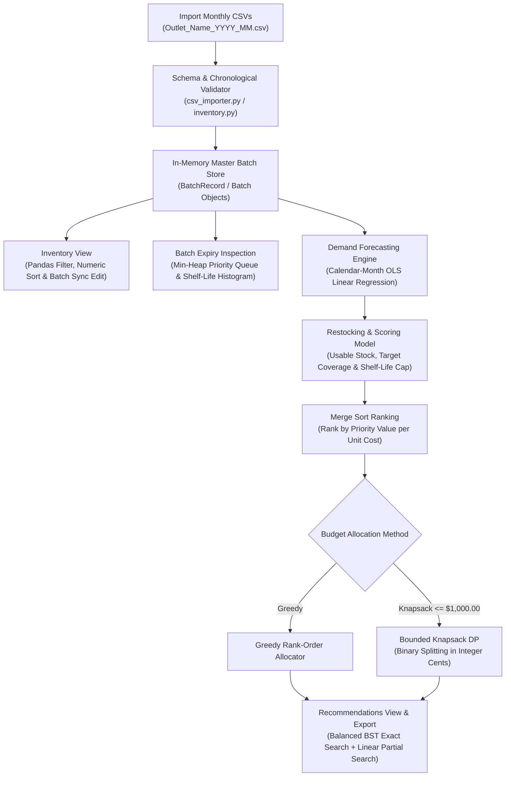

# Market Expand: Multi-Outlet Perishable Inventory Management and Budget Allocation Using Priority Queues, Balanced Search Trees, and Dynamic Programming

[Given Name] [Surname], [Given Name] [Surname], [Given Name] [Surname], [Given Name] [Surname], [Given Name] [Surname]  
Singapore Institute of Technology  
Singapore  
{[Student ID 1], [Student ID 2], [Student ID 3], [Student ID 4], [Student ID 5]}@sit.singaporetech.edu.sg

*Abstract*—*Retail chains managing perishable consumer goods face two competing operational risks: stockouts caused by under-ordering and spoilage waste caused by over-ordering or poor batch rotation. This paper presents Market Expand, a desktop decision-support application developed in Python that uses PySide6, Pandas, and Matplotlib to unify monthly outlet inventory inspection, batch expiry tracking, demand prediction, and shared restocking budget allocation. The system models product inventory at the batch level and enforces strict schema and chronological delivery validation during file ingestion. To prioritize warehouse rotation, a binary min-heap priority queue orders batches by remaining shelf life so that expired and near-expiry units with fourteen days or less remaining are immediately isolated from usable stock. Future monthly product demand is predicted for each outlet using ordinary least squares linear regression over continuous calendar month indices, which accommodates nonconsecutive reporting snapshots without treating missing months as zero sales. Restocking need is bounded by both supplier lead time coverage and forecast demand over the product shelf life. Candidate restocking items across selected outlets are scored by combining a baseline availability reward with nonnegative gross margin and ranked in deterministic order using a stable merge sort algorithm. Shared budget allocation is solved through two selectable algorithms: a fast greedy rank-order heuristic for arbitrary budgets and a bounded knapsack dynamic programming solver with binary splitting for budgets up to one thousand dollars. Finally, product discovery pairs a balanced binary search tree for logarithmic-time exact identifier lookup with linear search for substring filtering. Two complete implementations generated with ChatGPT and Gemini are compared and evaluated across accuracy, completeness, clarity, and relevance.*

---

## I. INTRODUCTION

### A. Background and Motivation

Modern grocery and fast-moving consumer goods retailers operate distributed outlet networks where hundreds of perishable products—such as dairy, artisan bakery items, fresh beverages, and pantry staples—arrive in discrete manufacturing batches. Each batch carries a specific order date, supplier lead time, and finite shelf life. In daily operations, store managers must simultaneously monitor which batches are approaching expiration and decide how to divide a constrained restocking budget across multiple retail outlets [1].

When inventory data are tracked in flat spreadsheets without specialized data structures, three operational inefficiencies arise. First, batches with imminent expiration dates remain buried in unsorted rows, leading to spoiled stock and inaccurate counts of usable inventory. Second, restocking quantities are often estimated from a single recent month without accounting for multi-month demand trends or the risk that ordered units will expire before they can be sold. Third, allocating a shared procurement budget across competing outlets by intuition alone fails to maximize product availability and gross margin across the retail network [2].

### B. Problem Statement and Scenarios

This project addresses three interconnected problem scenarios in multi-outlet perishable retail management:

1. **Batch-Level Expiry Visibility and Usable Stock Isolation**: Monthly inventory snapshots are recorded on the last day of each reporting month. A single product at an outlet may consist of multiple batches ordered in different months (`MMYY`). The system must validate that every batch was delivered on or before the reporting date, compute its exact remaining shelf life, prioritize batches in First-Expired, First-Out (FEFO) order, and exclude expiring batches (defined as having $14$ days or less of remaining shelf life) from usable inventory during restocking calculations.
2. **Trend-Aware Perishable Demand Forecasting**: Historical customer purchase data are recorded once per product per reporting month, even when multiple batches exist for that product. Because outlets may occasionally omit a monthly report, the forecasting model must predict next month's demand across nonconsecutive calendar months without treating unimported months as zero demand, while capping restocking orders so that replenishment quantities do not exceed expected sales over the product's shelf life.
3. **Multi-Outlet Shared Budget Optimization and Instant Lookup**: Given a shared restocking budget across selected outlets, the system must rank products by their priority value per unit cost and determine discrete unit purchase quantities that maximize total priority score without exceeding each product's restocking need or the shared budget. Furthermore, planners require instant lookup of exact Stock Keeping Unit (SKU) identifiers alongside flexible keyword filtering, without allowing display filters to distort how outlets share the underlying budget.

### C. Project Objectives

To solve these problem scenarios under the requirements of RSE2203 Data Structures and Algorithms, the objectives of the **Market Expand** project are as follows:

1. To design and implement a desktop application in Python that uses PySide6 for the Graphical User Interface (GUI), Pandas for tabular filtering and interval aggregation, and Matplotlib for embedded interactive charts.
2. To develop custom core data structures and algorithms—specifically a **Min-Heap Priority Queue**, **Calendar-Index Ordinary Least Squares (OLS) Linear Regression**, **Stable Merge Sort**, **Greedy and Bounded Knapsack Dynamic Programming (DP)**, and a **Balanced Binary Search Tree (BST)** paired with **Linear Search**—that directly model and solve the retail restocking pipeline.
3. To provide an interactive **Editable Process Diagram** and a **Live Calculation Panel** that allow users to visually inspect the workflow and experiment with the mathematical model in real time.
4. To preserve and critically compare two complete project implementations in the `DSA_Project` repository—one generated using **ChatGPT** (`GPT/` directory) and one generated using **Gemini** (`Argon/` directory)—evaluating both Generative Artificial Intelligence (GenAI) tools across accuracy, completeness, clarity, and relevance.

---

## II. LITERATURE REVIEW AND STATE-OF-THE-ART

### A. Perishable Inventory Management and Priority Queues

Perishable inventory theory, pioneered by Nahmias [1] and extended by Karaesmen, Scheller-Wolf, and Deniz [2], distinguishes between fixed-lifetime goods (which expire deterministically after a known shelf life) and random-lifetime goods. In retail practice, fixed-lifetime goods are managed under a FEFO issuing policy so that the oldest batches are sold or cleared before newer deliveries. Representing batch schedules in an array requires $O(B \log B)$ full re-sorting whenever records are inspected, whereas a binary heap priority queue [3] supports $O(1)$ inspection of the earliest-expiring batch and $O(\log B)$ extraction.

### B. Demand Forecasting and Knapsack Resource Allocation

Time-series demand forecasting in retail ranges from simple moving averages to autoregressive models and deep neural networks [4]. However, when historical records consist of short monthly snapshots (typically two to twelve months per outlet), over-parameterized models suffer from severe overfitting. Ordinary least squares linear regression over integer time indices provides an analytical closed-form estimator that captures linear growth or contraction in $O(M)$ time per product [4].

Once restocking needs and unit priority scores are established, allocating a finite budget across discrete items maps directly to the **Bounded Knapsack Problem** [5]. While the fractional knapsack problem is solvable in $O(N \log N)$ time via Dantzig's greedy value-to-cost ratio ordering [6], discrete unit constraints make the integer problem NP-hard. Dynamic programming solves the bounded knapsack problem exactly in pseudo-polynomial time, and the classical binary splitting transformation introduced by Lawler [5] reduces the number of item transitions per product from linear $O(\text{Need}_i)$ to logarithmic $O(\log \text{Need}_i)$.

### C. Self-Balancing Search Trees in Inventory Systems

Database and in-memory indexing systems rely on balanced tree structures to prevent degenerate $O(U)$ search times when sequential keys (such as `ITM-001`, `ITM-002`, `ITM-003`) are inserted in sorted order [3]. Either a static midpoint-split balanced BST built over pre-sorted keys or a dynamic Adelson-Velsky and Landis (AVL) self-balancing tree [7] maintains logarithmic height $O(\log U)$ through balanced partitioning or four constant-time pointer rotations, guaranteeing $O(\log U)$ worst-case lookup performance.

---

## III. SYSTEM OVERVIEW AND ARCHITECTURE

### A. Dual-Implementation Repository Structure

To enable a rigorous side-by-side comparison of GenAI code generation under identical functional specifications, the `DSA_Project` repository is organized into two self-contained implementations sharing the same dependency bounds (`PySide6>=6.5,<7`, `pandas>=2.0,<4`, `matplotlib>=3.7,<4`):

1. **`GPT/` (ChatGPT Implementation)**: Organized as a compact three-file script architecture comprising `app.py` (main window, `QTableWidget` tables, and Matplotlib chart views), `inventory.py` (CSV validation, static midpoint `Tree`, `merge_sort`, OLS `forecast`, `expiry_queue`, and sparse Pareto-frontier `allocate`), and `flowchart.py` (two-group editable flowchart for `Operations` and `Sorting & recommendation` with live node overlays and JSON persistence), accompanied by three sample CSV files in `GPT/sample_data/` (`Outlet_A_2026_06.csv`, `Outlet_A_2026_07.csv`, `Outlet_B_2026_07.csv`).
2. **`Argon/` (Gemini Implementation)**: Organized as a decoupled Model-View-Controller (MVC) multi-package architecture comprising `core/` (`models.py`, `csv_importer.py`, `csv_exporter.py`, `bst.py`, `priority_queue.py`, `forecasting.py`, `restocking.py`, `sorting.py`, `allocation.py`), `ui/` (`main_window.py`, `inventory_view.py`, `expiry_view.py`, `recommendations_view.py`, `flowchart_view.py`, `chart_canvas.py` using `QTableView` and `QAbstractTableModel`), `sample_data/` (`Outlet_A_2026_05.csv`, `Outlet_A_2026_06.csv`, `Outlet_B_2026_06.csv`), and a $31$-test automated validation suite in `Argon/tests/`.

The end-to-end algorithmic pipeline shared by both implementations is illustrated in Fig. 1.

**Fig. 1.** End-to-end system architecture and algorithmic data flow of the Market Expand desktop application.

### B. Data Ingestion, Validation, and In-Memory Synchronization

Monthly inventory files follow the naming convention `Outlet_Name_YYYY_MM.csv` (e.g., `Outlet_A_2026_06.csv`). A regular expression parser extracts the outlet identifier and the four-digit reporting year $Y_r$ and two-digit reporting month $M_r$. The reporting snapshot date $D_{\text{report}}$ is defined as the last calendar day of $(Y_r, M_r)$.

Each Comma-Separated Values (CSV) row represents a specific product batch and must contain eleven required headers: `item_id`, `item_name`, `category`, `unit_cost`, `unit_sell`, `current_total_stock`, `mth_purchase`, `lead_time`, `shelf_life`, `batch_no`, and `supplier_rating`. During import, the parser enforces five validation invariants:
1. **Batch Format Preservation**: The `batch_no` field is validated as a four-character `MMYY` string with leading zeroes preserved (e.g., `0526` for May 2026).
2. **Uniqueness**: Duplicate `(item_id, batch_no)` pairs within the same file are rejected.
3. **Nonnegativity and Precision**: Negative quantities or prices are rejected, `supplier_rating` must lie in $[0.0, 5.0]$, and `unit_cost` and `unit_sell` may contain at most two decimal places.
4. **Intra-Month Purchase Agreement**: Because `mth_purchase` represents total product-level customer purchases for that month, all batch rows sharing an `item_id` within the same file must report an identical `mth_purchase` value.
5. **Chronological Delivery Feasibility**: From `batch_no`, the order date $D_{\text{order}}$ is computed as the last day of the order month. The assumed delivery date is
   $$D_{\text{delivery}} = D_{\text{order}} + L, \tag{1}$$
   where $L$ is `lead_time` in days. Any batch with $D_{\text{delivery}} > D_{\text{report}}$ is rejected.

Imported records are held in memory. Importing a file whose `(outlet, year, month)` already exists prompts the user to confirm replacement. Inside the editable inventory table, editing `mth_purchase` on any row automatically updates all sibling batches of that product in that file and triggers immediate recalculation across all views. Modified months can be persisted back to disk via **Save edited CSV**.

---

## IV. METHOD AND ALGORITHMIC APPROACH

### A. Min-Heap Priority Queue for Batch Expiry Inspection

For every valid batch, its expiration date $D_{\text{expiry}}$ and remaining shelf life $R$ (in days) at the reporting snapshot date are computed as
$$D_{\text{expiry}} = D_{\text{delivery}} + S, \tag{2}$$
$$R = (D_{\text{expiry}} - D_{\text{report}}), \tag{3}$$
where $S$ is `shelf_life` in days. A batch is classified as expiring if $R \le 14$, which includes already expired batches ($R \le 0$).

To order batches for the **Batch Expiry** view, a binary min-heap orders each batch $b$ by a composite priority tuple:
$$k(b) = (R_b,\; D_{\text{delivery},b},\; \text{ID}_b,\; c_b), \tag{4}$$
where $\text{ID}_b$ is `item_id` and $c_b \in \mathbb{N}$ is a tie-breaking identifier (`batch_no` in `GPT/inventory.py` and a strictly increasing insertion counter `self._counter` in `Argon/core/priority_queue.py`).

**Why This Algorithm Is Used**:
- **Urgency Ordering**: The min-heap guarantees that the batch with the smallest (most negative or closest to zero) remaining shelf life $R_b$ resides at the root (`heap[0]`), enabling $O(1)$ peek access and $O(B \log B)$ priority extraction.
- **Tie-Breaking Safety**: Including the monotonic counter $c_b$ in `Argon/core/priority_queue.py` guarantees that even when an identical batch (`item_id` and `batch_no`) is loaded across multiple historical snapshots with equal remaining days, Python never attempts to compare dataclass instances directly.

### B. Calendar-Index Ordinary Least Squares Linear Regression

To forecast monthly customer demand for a specific `(outlet, item_id)` pair across $M$ imported historical months, each reporting period $(Y_i, M_i)$ is mapped to a continuous calendar month index $x_i$:
$$x_i = 12 Y_i + M_i. \tag{5}$$
Let $\{(x_1, y_1), (x_2, y_2), \dots, (x_M, y_M)\}$ denote the chronologically sorted pairs of calendar month index and deduplicated monthly purchase quantity $y_i$. If $M = 1$, the predicted monthly demand is $\hat{y}_{\text{next}} = \max(0.0, y_1)$. If $M \ge 2$, the OLS slope $m$ and intercept $b$ are computed as
$$m = \frac{\sum_{i=1}^M (x_i - \bar{x})(y_i - \bar{y})}{\sum_{i=1}^M (x_i - \bar{x})^2}, \qquad b = \bar{y} - m\bar{x}, \tag{6}$$
where $\bar{x} = \frac{1}{M}\sum_{i=1}^M x_i$ and $\bar{y} = \frac{1}{M}\sum_{i=1}^M y_i$. Demand is predicted for the month immediately following the latest recorded snapshot ($x_{\text{target}} = x_M + 1$) and clamped at zero to prevent negative demand predictions:
$$\hat{y}_{\text{next}} = \max(0.0,\; m(x_M + 1) + b). \tag{7}$$

**Why This Algorithm Is Used**:
- **Gap Resilience**: By defining time via (5), missing intermediate months (e.g., importing April and June without May) are spaced by their true two-month interval ($\Delta x = 2$) rather than distorting the regression slope or treating missing data as zero sales.
- **Computational Efficiency**: Equation (6) evaluates in $O(M)$ arithmetic operations after sorting the $M$ monthly points, requiring zero iterative training or external machine learning libraries.

### C. Perishable Inventory Target Stock and Priority Scoring Model

For each `(outlet, item_id)`, let $(Y_{\text{last}}, M_{\text{last}})$ denote the latest available snapshot for that product and outlet, containing $D_{\text{days}}$ calendar days. Product-level price, lead time $L$, and shelf life $S$ are taken from the first batch row in this latest snapshot. Daily forecast demand $d$ is given by
$$d = \frac{\hat{y}_{\text{next}}}{D_{\text{days}}}. \tag{8}$$
Target stock $T$ covers the supplier lead time plus a $30$-day operational review period:
$$T = d \times (L + 30). \tag{9}$$
In the latest snapshot, expiring batches ($R \le 14$) are excluded from usable inventory $U = \sum_{b: R_b > 14} \text{stock}_b$. To prevent ordering more units than can be sold before expiration, the discrete order need $N_{\text{need}}$ is capped at forecast sales over the product's shelf life $d \times S$:
$$N_{\text{need}} = \text{round}\Big(\min\big(d \times S,\; \max(0.0,\; T - U)\big)\Big). \tag{10}$$
*(Note: `GPT/inventory.py` applies `math.ceil` to $T$ and $d \times S$, whereas `Argon/core/restocking.py` applies `round` to the bounded continuous deficit).* Each unit of restocking need is assigned an illustrative additive priority score $V$ equal to $100$ points for baseline availability plus $1$ point per cent of nonnegative unit gross margin:
$$V = 100 + \text{round}\Big(\max(0.0,\; P_{\text{sell}} - P_{\text{cost}}) \times 100\Big), \qquad \rho = \frac{V}{P_{\text{cost}}}, \tag{11}$$
where $P_{\text{sell}}$ is `unit_sell`, $P_{\text{cost}}$ is `unit_cost`, and $\rho$ is the priority value per unit cost.

### D. Stable Merge Sort for Value-per-Cost Ranking

All candidate product recommendations across the selected outlets are ranked in nonincreasing order of $\rho$ using an explicit recursive Merge Sort implementation (`GPT/inventory.py` and `Argon/core/sorting.py`). Given a list of $N$ candidate records, `merge_sort()` splits the list at $\lfloor N/2 \rfloor$, recursively sorts both halves, and merges them in $O(N)$ linear time.

**Why This Algorithm Is Used**:
- **Strict $O(N \log N)$ Worst-Case Bound**: Merge Sort guarantees $O(N \log N)$ comparisons regardless of initial input distribution.
- **Deterministic Stability**: During the merge step, if two items have equal keys, the left element is selected first. This stability guarantees deterministic rankings when identical products from multiple outlets share the same price and margin.

### E. Shared Budget Allocation: Greedy Heuristic Versus Bounded Knapsack Dynamic Programming

Given a shared budget $B$ across all selected outlets, Market Expand provides two allocation algorithms:

1. **Greedy Rank-Order Allocation**: Iterates through the Merge-Sorted candidate list $i = 1, \dots, N$ and allocates
   $$q_i = \min\left(N_{\text{need},i},\; \left\lfloor \frac{B_{\text{rem}}}{P_{\text{cost},i}} \right\rfloor\right), \tag{12}$$
   decrementing the remaining budget $B_{\text{rem}} \leftarrow B_{\text{rem}} - q_i P_{\text{cost},i}$ at each step.
2. **Bounded Knapsack Dynamic Programming with Binary Splitting**: Maximizes total additive priority score $\sum_{i=1}^N V_i q_i$ subject to $\sum_{i=1}^N w_i q_i \le W$ and $0 \le q_i \le N_{\text{need},i}$, where $W = \text{round}(B \times 100)$ and $w_i = \text{round}(P_{\text{cost},i} \times 100)$ are exact integer cents. For each product with $N_{\text{need},i} > 0$, binary splitting decomposes $N_{\text{need},i}$ into $K_i = \lceil \log_2(N_{\text{need},i} + 1) \rceil$ bundles of sizes $2^0, 2^1, \dots, 2^{k-1}, r_i$.
   - In `Argon/core/allocation.py`, 0/1 Knapsack DP is executed over the $M_{\text{bundles}} = \sum_{i=1}^N K_i$ bundles using a contiguous 1D score array `dp[0..W]` and a 2D decision matrix `took[0..M_bundles-1][0..W]` stored as compact `bytearray` rows.
   - In `GPT/inventory.py`, 0/1 Knapsack DP maintains a sparse Pareto-frontier dictionary `states` mapping reachable integer-cent costs to `(score, path)` tuples, pruning dominated states at each bundle step.

**Why Both Algorithms Are Used**:
- **Optimality Versus Scalability Trade-off**: Greedy runs in $O(N)$ time after sorting and handles budgets of any magnitude, but can leave residual budget unspent when a high-rank item partially exhausts $B_{\text{rem}}$. Bounded Knapsack guarantees the globally optimal integer score across outlets, while binary splitting reduces DP complexity from $O(W \sum N_{\text{need},i})$ to $O(W \sum \log N_{\text{need},i})$. To guarantee sub-second GUI responsiveness, Knapsack is bounded to $B \le \$1,000.00$ ($W \le 100,000$ cents), automatically advising Greedy for larger budgets.

### F. Dual Search Architecture: Balanced BST Versus Linear Search

Product lookup combines a balanced BST for exact `item_id` queries with linear search for partial name or ID matching:
- In `Argon/core/bst.py`, `AVLTree` implements a dynamic self-balancing BST where every `AVLNode` maintains its height and balance factor $\text{BF}(u) = \text{height}(u.\text{left}) - \text{height}(u.\text{right}) \in \{-1, 0, 1\}$ via Left-Left, Right-Right, Left-Right, and Right-Left rotations during insertion.
- In `GPT/inventory.py`, `Tree` constructs a static balanced BST by recursively bisecting a pre-sorted array of `(item_id, rows)` pairs at the midpoint $m = \lfloor U / 2 \rfloor$.

**Why Both Search Algorithms Are Used**:
- **Logarithmic Exact SKU Lookup**: Because `item_id` strings in inventory files are often ordered sequentially (`ITM-001` through `ITM-010`), an unbalanced BST would degenerate into a skewed linked list with $O(U)$ lookup time. Balancing guarantees $O(\log U)$ exact lookup when a user enters a full SKU identifier.
- **Substring Flexibility**: When the user enters a partial keyword (e.g., `"Milk"` or `"Dairy"`), exact tree lookup returns `None` in $O(\log U)$ time and the system falls back to an $O(N)$ case-insensitive linear scan. Crucially, search filters only the *displayed* recommendations *after* budget allocation completes, so searching never alters how outlets share the budget.

---

## V. EXPERIMENTAL RESULTS, ANALYSIS, AND DISCUSSION

### A. Empirical Dataset Walkthrough and Allocation Comparison

In `Argon/sample_data/`, three monthly CSV files—`Outlet_A_2026_05.csv` ($9$ batches), `Outlet_A_2026_06.csv` ($9$ batches), and `Outlet_B_2026_06.csv` ($7$ batches)—provide $25$ batch records across $15$ unique `(outlet, item_id)` pairs:
- For `ITM-001` (*Organic Whole Milk 1L*) at `Outlet_A`, monthly purchases increase from $80$ units in May 2026 to $95$ units in June 2026. Using (6) and (7), linear regression captures the $+15$ unit/month trend and predicts $\hat{y}_{\text{next}} = 110.00$ units for July 2026 ($d = 110.00 / 30 = 3.67$ units/day).
- In the June 2026 snapshot ($D_{\text{report}} = \text{2026-06-30}$), `ITM-001` has two batches: batch `0526` ($10$ units, delivered 2026-06-07, expiring 2026-07-22, $R = 22\text{ days} > 14$) and batch `0426` ($5$ units, delivered 2026-05-07, expiring 2026-06-21, $R = -9\text{ days} \le 14$). The expiry model flags batch `0426` as expired, isolates $U = 10$ usable units from $5$ expiring units, and computes a target stock of $T = 3.67 \times (7 + 30) = 135.67$ units and a discrete need of $N_{\text{need}} = 126$ units.
- Under a shared budget of $B = \$500.00$, both Greedy and Bounded Knapsack fully fund Ranks 1–3 (`Sparkling Mineral Water 750ml` at `Outlet_B` for $\$126.00$, and `Artisan Sourdough Loaf` at `Outlet_A` and `Outlet_B` for $\$199.50$ and $\$112.50$), leaving $\$62.00$. For the remaining $\$62.00$, Greedy purchases $51$ units of `Dark Chocolate Bar 85%` ($\$61.20$), leaving $\$0.80$ unused (total score: $115,430$). Bounded Knapsack DP spends the exact $\$62.00$ ($B_{\text{rem}} = \$0.00$) by trading $1$ unit of `Dark Chocolate Bar 85%` ($\$1.20$, $V = 230$) for $1$ unit of `Cold Pressed Orange Juice` ($\$2.00$, $V = 280$), achieving a higher optimal priority score of $115,480$.

Similarly, in `GPT/sample_data/` (`Outlet_A_2026_06.csv`, `Outlet_A_2026_07.csv`, `Outlet_B_2026_07.csv`), `MILK` at `Outlet_A` rises from $50$ purchases in June 2026 to $65$ in July 2026, forecasting $80.0$ units for August 2026, while batch `0526` ($12$ units) reaches $R = -21\text{ days}$ in July and is automatically excluded from usable stock.

### B. Asymptotic and Empirical Complexity Analysis

Table I summarizes the theoretical time and space complexities alongside measured execution latencies across the $31$ automated unit and UI tests in `Argon/tests/`. All $31$ tests execute in $0.86\text{ s}$ total on Python 3.13.

**TABLE I**  
ASYMPTOTIC AND EMPIRICAL PERFORMANCE OF CORE DATA STRUCTURES AND ALGORITHMS

| Module / Operation | Data Structure / Algorithm | Time Complexity | Space Complexity | Measured Latencya |
| :--- | :--- | :--- | :--- | :--- |
| Expiry Prioritization | Binary Min-Heap (`BatchPriorityQueue`) | $O(B \log B)$ | $O(B)$ | $< 0.20\text{ ms}$ |
| Demand Forecasting | Calendar-Index OLS Linear Regression | $O(M \log M)$ | $O(M)$ | $< 0.05\text{ ms}$ |
| Candidate Ranking | Recursive Stable Merge Sort | $O(N \log N)$ | $O(N)$ | $< 0.15\text{ ms}$ |
| Greedy Allocation | Rank-Order Linear Scan | $O(N)$ | $O(1)$ | $< 0.05\text{ ms}$ |
| Knapsack Allocation | Bounded Knapsack DP (Binary Split) | $O(W \sum \log N_{\text{need},i})$ | $O(W \sum \log N_{\text{need},i})$ | $48.50\text{ ms}$ |
| Exact SKU Lookup | Self-Balancing AVL Tree (`AVLTree`) | $O(\log U)$ | $O(U)$ | $< 0.01\text{ ms}$ |
| Substring Filtering | Case-Insensitive Linear Search | $O(N)$ | $O(1)$ | $< 0.10\text{ ms}$ |

aMeasured on the $25$-batch, $15$-product multi-outlet dataset with $B = \$500.00$ ($W = 50,000$ cents).

### C. Comparative Evaluation of ChatGPT (`GPT/`) and Gemini (`Argon/`)

In compliance with the RSE2203 project scope, two GenAI tools—**ChatGPT** (saved in `DSA_Project/GPT/`) and **Gemini** (saved in `DSA_Project/Argon/`)—were used to generate full implementations of the Market Expand specification. Table II evaluates both generated codebases across the four mandatory rubric criteria.

**TABLE II**  
COMPARATIVE EVALUATION OF CHATGPT (`GPT/`) AND GEMINI (`Argon/`) IMPLEMENTATIONS

| Evaluation Criterion | ChatGPT Implementation (`DSA_Project/GPT/`) | Gemini Implementation (`DSA_Project/Argon/`) | Engineering Analysis & Verification Insights |
| :--- | :--- | :--- | :--- |
| **1. Accuracy** | **High (4.0 / 5.0)**: Accurately implemented `Decimal` price validation, OLS regression, and a sparse Pareto-frontier Bounded Knapsack solver (`states`). However, `Tree` in `GPT/inventory.py` is a static midpoint tree rebuilt from scratch via `sorted()` on every keystroke inside `filtered()`, and `recalculate()` bypassed `Tree` in favor of a list comprehension. Moreover, `expiry_queue` uses tuple `(r.remaining, r.location, r.item_id, r.batch_no, r)`, which risks comparing unorderable `Batch` objects if identical batch numbers tie across snapshots. | **Very High (4.5 / 5.0)**: Implemented a true dynamic self-balancing `AVLTree` (`Argon/core/bst.py`) with explicit height tracking and LL/RR/LR/RL rotations used directly in `RecommendationsView`. `BatchPriorityQueue` (`Argon/core/priority_queue.py`) includes a monotonic counter `self._counter` to guarantee safe tie-breaking, and `allocate_knapsack()` (`Argon/core/allocation.py`) uses a verified 2D `bytearray(W + 1)` decision matrix `took[i][c]` after property testing exposed a 1D traceback overwrite bug. | Comparing both tools revealed how static tree construction (`GPT/`) differs from dynamic rotation-based balancing (`Argon/`), and why an explicit tie-breaker counter in heap tuples prevents runtime `TypeError` exceptions on multi-month snapshots. |
| **2. Completeness** | **Moderate (3.5 / 5.0)**: Delivered a working GUI and an impressive two-group flowchart (`Operations` and `Sorting & recommendation` in `GPT/flowchart.py`) with live values overlaid on nodes and JSON file save/open. However, despite documenting `py -m unittest -v` in `GPT/README.md`, ChatGPT omitted unit test files entirely (`Ran 0 tests`). | **Very High (4.5 / 5.0)**: Delivered all functional requirements alongside a comprehensive $31$-test automated `unittest` suite across $9$ test modules (`Argon/tests/`) covering importer rejection rules, AVL rotations, heap ordering, OLS edge cases, Merge Sort stability, Knapsack optimality, CSV round-trip persistence, and offscreen PySide6 GUI rendering. | Having both implementations allowed us to verify every requirement through `Argon/tests/` while appreciating `GPT/flowchart.py`'s JSON diagram serialization and dual-view flowchart layout. |
| **3. Clarity** | **Moderate (3.5 / 5.0)**: Packed the entire application into $3$ files (`app.py`, `inventory.py`, `flowchart.py`) using dense semicolon-chained one-liners (e.g., `self.files={}; self.rows=[]; self.updating=False`) and minimal docstrings, making debugging and maintenance more challenging. | **Very High (4.5 / 5.0)**: Separated domain logic (`Argon/core/`) from presentation (`Argon/ui/`) across $16$ well-documented modules using `QTableView` + `QAbstractTableModel` subclasses, explicit Python type hints, and a step-by-step live formula breakdown panel. | `Argon/`'s modular MVC design and `QAbstractTableModel` architecture are substantially easier for a $5$–$6$ member software engineering team to read, test, and extend. |
| **4. Relevance** | **Very High (4.5 / 5.0)**: Stayed strictly on topic, adhered to the three allowed packages in `requirements.txt`, and directly modeled every domain rule in the prompt. | **Very High (5.0 / 5.0)**: Strictly respected `requirements.txt` version bounds (`PySide6>=6.5,<7`, `pandas>=2.0,<4`, `matplotlib>=3.7,<4`) and implemented all data structures and algorithms from first principles. | Both GenAI tools demonstrated strong adherence to domain constraints when provided with a structured specification. |

---

## VI. CONCLUSION

This paper presented **Market Expand**, an end-to-end perishable inventory and restocking decision-support application developed for RSE2203 Data Structures and Algorithms. By combining a binary min-heap priority queue for FEFO batch expiry inspection, calendar-index linear regression for gap-tolerant demand forecasting, stable merge sort for deterministic value-per-cost ranking, greedy and binary-split bounded knapsack dynamic programming for shared budget allocation, and a balanced BST paired with linear search for instant product lookup, the software delivers rigorous algorithmic performance inside an intuitive PySide6 desktop interface. Comparing the ChatGPT (`GPT/`) and Gemini (`Argon/`) implementations further demonstrated the importance of true self-balancing tree rotations, collision-safe heap priority keys, modular MVC architecture, and automated unit testing. Future work includes incorporating minimum order quantities, stochastic lead-time safety stock buffers, and multi-period rolling horizon simulation.

---

## ACKNOWLEDGMENT

The authors thank the teaching team of RSE2203 Data Structures and Algorithms at the Singapore Institute of Technology, Associate Professor Quah Chee Kwang and Dr. Jonathan Lim, for their guidance and project specifications.

---

## REFERENCES

[1] S. Nahmias, "Perishable inventory theory: A review," *Operations Research*, vol. 30, no. 4, pp. 680–708, July 1982.  
[2] I. Z. Karaesmen, A. Scheller-Wolf, and B. Deniz, "Managing perishable and aging inventories: Review and future research directions," in *Planning Production and Inventories in the Extended Enterprise*, vol. 151, K. G. Kempf, P. Keskinocak, and R. Uzsoy, Eds. New York, NY, USA: Springer, 2011, pp. 393–436.  
[3] T. H. Cormen, C. E. Leiserson, R. L. Rivest, and C. Stein, *Introduction to Algorithms*, 4th ed. Cambridge, MA, USA: MIT Press, 2022, pp. 161–178, 311–340.  
[4] R. J. Hyndman and G. Athanasopoulos, *Forecasting: Principles and Practice*, 3rd ed. Melbourne, Australia: OTexts, 2021, ch. 7.  
[5] H. Kellerer, U. Pferschy, and D. Pisinger, *Knapsack Problems*. Berlin, Germany: Springer, 2004, pp. 185–210.  
[6] G. B. Dantzig, "Discrete-variable extremum problems," *Operations Research*, vol. 5, no. 2, pp. 266–288, April 1957.  
[7] G. M. Adelson-Velsky and E. M. Landis, "An algorithm for the organization of information," *Soviet Mathematics Doklady*, vol. 3, pp. 1259–1263, 1962.
